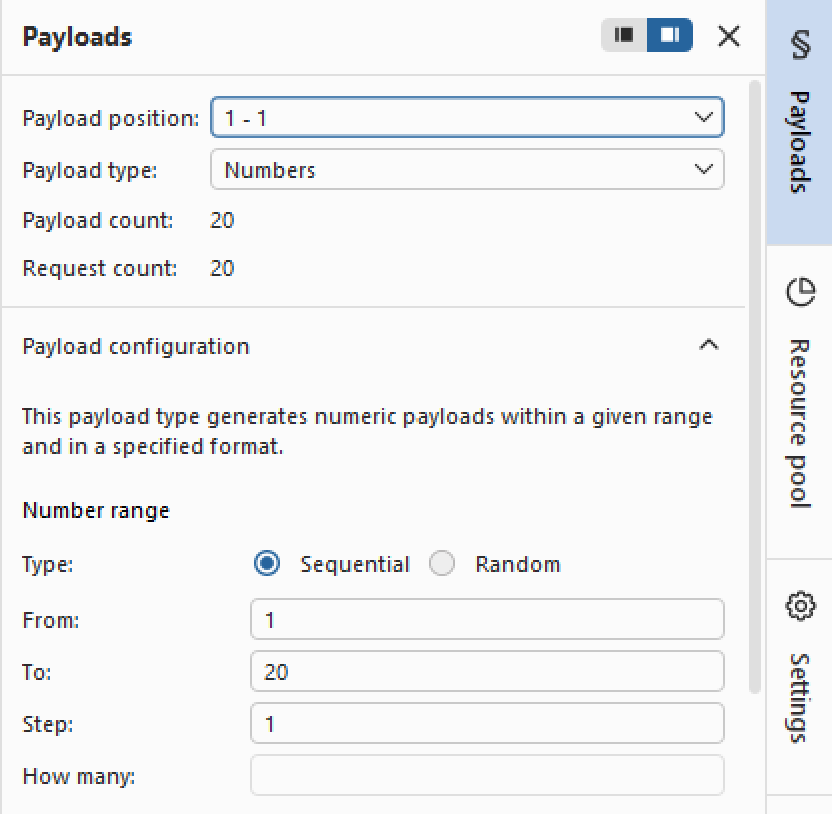
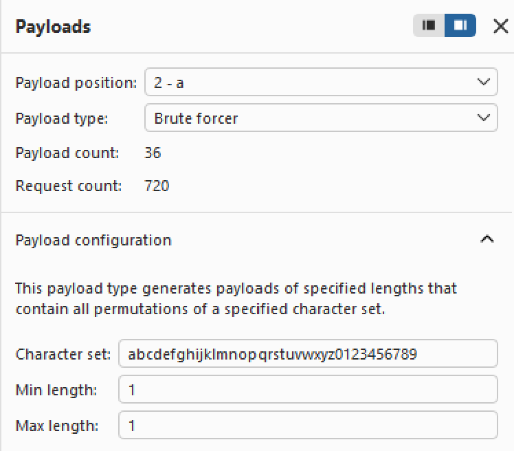

# Write-up: Blind SQL injection with conditional responses   
  
Lab-link: https://portswigger.net/web-security/sql-injection/blind/lab-conditional-responses  
Difficulty: Practitioner   
Status: Solved  

## Lab description  
 

## Objectives 
Retrieve the password of `administrator` user and log into their account  

## Background  
### Blind SQL injection  
Blind SQL injection occurs when an application is vulnerable to SQL injection, but the results of the injected query are not directly displayed in the response. Instead, information must be inferred from differences in the application's behavior.  
In this lab, the presence or absence of the **Welcome back!** message is used to determine whether an injected condition is true or false  

### Conditional responses  
A **conditional response** is a visible difference in the application's response depending on whether an SQL condition is true or false.  
For example:  
`' AND 1=1--` causes **Welcome back!** to appear, while:  
`' AND 1=2--` does not.  
This difference allows the response to be used as a **Boolean oracle** during the attack.  

### `SELECT` subqueries  
A subquery is a SQL query nested inside another query.  
In this lab, subqueries are used to check information from the `users` table:  
```sql
SELECT 'x' FROM users WHERE username='administrator'
```
The result can then be used in a Boolean condition:  
```sql
(SELECT 'x' FROM users WHERE username='administrator')='x'
```
If the condition is true, **Welcome back!** appears.   

### Why use LIMIT 1?  
`LIMIT 1` restricts the subquery to a single row:  
```sql
SELECT 'x' FROM users LIMIT 1
```
For this attack, we only need to know whether at least one row exists, so returning multiple rows is unnecessary.

### `LENGTH()`  
`LENGTH()` returns the number of characters in a string.  

### `SUBSTRING()`  
`SUBSTRING()` extracts a specific part of a string using the following syntax:  
SUBSTRING(string, start, length)    
For example: `SUBSTRING(password,1,1)`  
`password`: the string to extract characters from.  
`1` (second parameter): the starting position of the character to extract. Positions start from 1.  
`1` (third parameter): the number of characters to extract.   

### Brute-force attack  
A **brute-force attack** systematically tests possible values until the correct one is found.  
In this lab, brute force is used to test possible password lengths and characters. For example, to find the first character, the attack can test: `a-z, 0-9`   
The character that produces the **Welcome back!** response is the correct one. 

### [Burp Intruder](https://portswigger.net/burp/documentation/desktop/tools/intruder)
Burp Intruder automates repeated HTTP requests with different payloads.  
It is useful in this lab because many similar requests must be sent to test different password lengths and characters.   

## Steps  
### 1. Establish a baseline  
Firstly, I chose the **Pets** category
In Burp Suite, I intercepted this request and sent it to Repeater  
   
The important parameter in this lab is the `trackingId` cookie

### 2. Confirm the parameter is vulnerable to blind SQL injection   
To determine whether `trackingId` could be manipulated with a Boolean condition, I tested 2 logically opposite payloads: **TRUE** `' AND 1=1--` and **FALSE** `' AND 1=2--`  
Both requests returned status `200 OK`.  
However, the response body was different  
`1=1` -> **Welcome back!** appeared  
`1=2` -> **Welcome back!** did not appear  
Therefore, I colud use the presence of **Welcome back!** message to determine whether an injected SQL condition was true or false  

### 3. Confirm that `users` table and `administrator` user exist  
First, I tested whether `users` table contained at least 1 record:     
```text
' AND (SELECT 'x' from users LIMIT 1)='x'--
```
```text
' AND (SELECT 'x' from users WHERE username='administrator')='x'--
```
Both responses returned **Welcome back!** message, so `users` table and `administrator` user existed    
 
### 4. Identify the password length  
I injected 2 payloads: 
```text
' AND (SELECT 'x' from users WHERE username='administrator' AND LENGTH(password)>1)='x'--
```
The response contained **Welcome back!** message  
```text
' AND (SELECT 'x' from users WHERE username='administrator' AND LENGTH(password)>30)='x'--
```
This time, **Welcome back!** did not appear   
Therefore, `1<the password length<=30`

Now, I sent the request to Intruder  
In the tab Burp Intruder, I selected the number used in `LENGTH(password)>§1§` as the payload position and clicked **Add §**  
I chose **Sniper attack** because there was only 1 payload position  
For the payload configuration:  
Payload type: `Numbers`  
From `1`  
To `30`  
Step `1`  
   
In Settings -> **Grep Match**, I removed the existing entries and added `Welcome back!`   


After starting attack, the response showed that the response contained **Welcome back!** for values from `1` to `19`, while the response for `20` did not contain the message   
This means: `LENGTH(password)=20`  
  

### 5. Retrieve the administrator password  
I used the following payload to test the first character of the password:     
```text
' AND (SELECT SUBSTRING(password,1,1) from users WHERE username='administrator')='a'--
```
I marked the character position and the character as two payload positions: `SUBSTRING(password,§1§,1)='§a§'`  
I used **Cluster bomb attack** because there are two independent values to test:  
The first position represents the character position in the password.  
The second position represents the character being tested.  
For the first payload position, I used:  
Payload type: `Numbers`  
From `1`  
To `20`  
Step `1`  
 
For the second payload position, I used Brute forcer to test possible characters.  
  
In Settings -> **Grep Match**, I added `Welcome back!`   
After starting the attack, I recorded the character that produced **Welcome back!** for each password position.  
  
The administrator password was: `il2mtulhg7q5dub2kqc4`  
And the lab was solved:  
  
