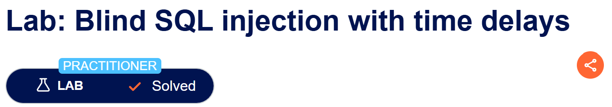
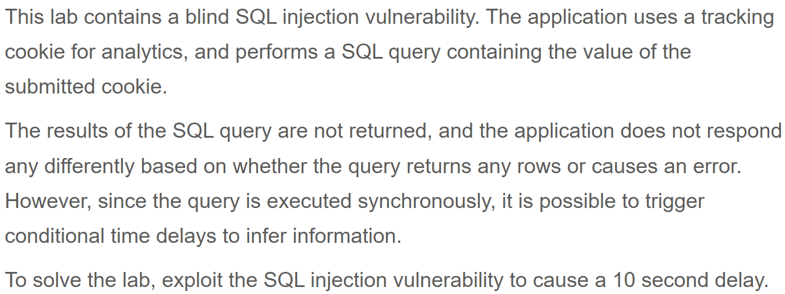

# Write-up: Blind SQL injection with time delays   
  
Lab-link: https://portswigger.net/web-security/sql-injection/blind/lab-time-delays  
Difficulty: Practitioner   
Status: Solved  

## Lab description  
 

## Objectives 
Cause the lab to delay 10 seconds  

## Background  
### Blind SQL injection  
Blind SQL injection occurs when an application is vulnerable to SQL injection, but the results of the injected query are not directly displayed in the response. Instead, information must be inferred from differences in the application's behavior.  
This lab is vulnerable to time-blind technique. I need to delay the lab to overpass.  

### [SQL injection cheat sheet](https://portswigger.net/web-security/sql-injection/cheat-sheet)
Use **String concatenation** and **Time delays** to attack this lab   

## Steps  
### 1. Establish a baseline  
Firstly, I chose **Gifts** category
In Burp Suite, I intercepted this request and sent it to Repeater

The important parameter in this lab is the trackingId cookie  

### 2. Test payload  
I injected each paylods for time delays and string concatenation to solve the lab  

The third payload ran with time delay 10,237millis  
  
And the lab was solved

