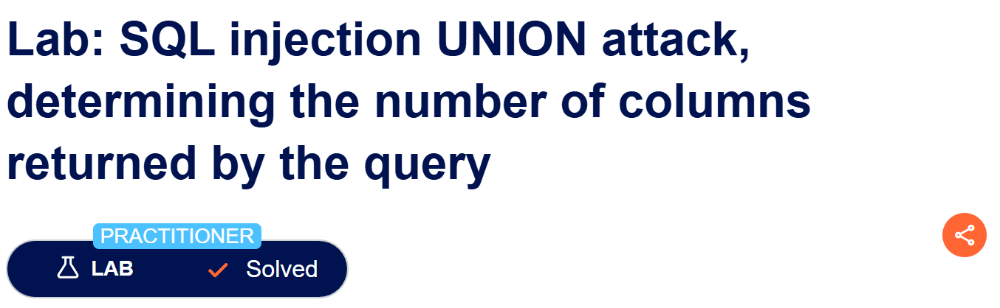
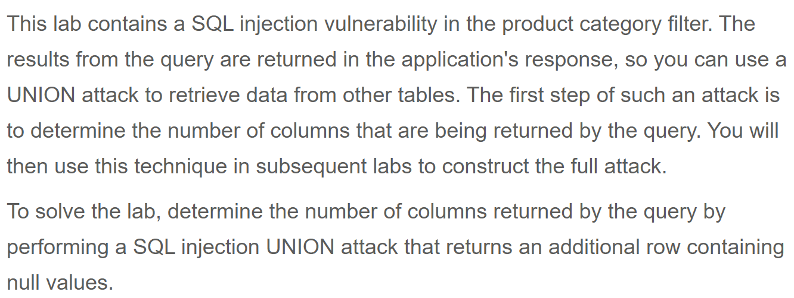

# Write-up: SQL injection UNION attack, determining the number of columns returned by the query  
  
Lab-link: https://portswigger.net/web-security/sql-injection/union-attacks/lab-determine-number-of-columns  
Difficulty: Practitioner  
Status: Solved  

## Lab description  
 

## Objectives  
Retrieve the number of columns returned by the query using UNION-based SQL injection

## Background  
