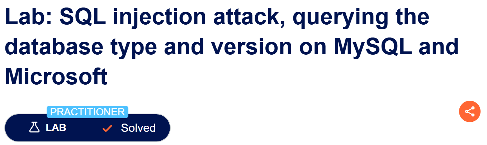
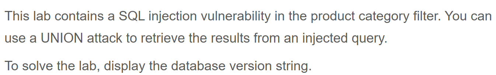

# Write-up: SQL injection attack, querying the database type and version on MySQL and Microsoft  
  
Lab-link: https://portswigger.net/web-security/sql-injection/examining-the-database/lab-querying-database-version-mysql-microsoft  
Difficulty: Practitioner  
Status: Solved  

## Lab description  
  

## Objectives  
Retrieve MySQL and Microsoft database version string using UNION-based SQL injection
## Background  

## Steps  
