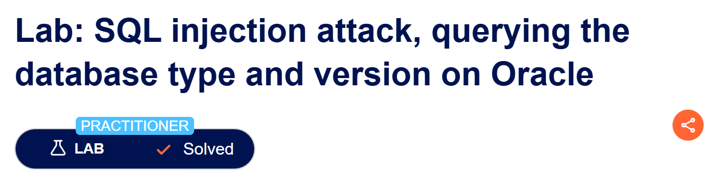
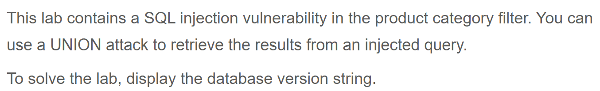
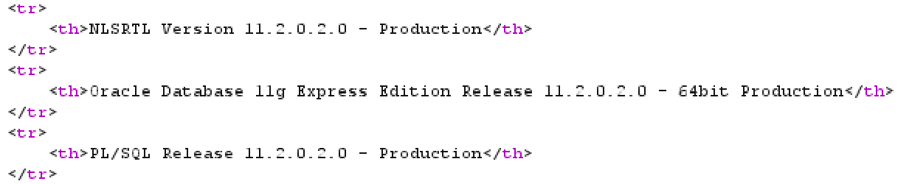
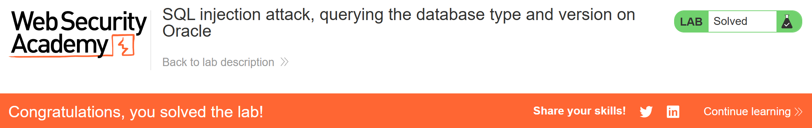

# Write-up: SQL injection attack, querying the database type and version on Oracle  
  
Lab-link: https://portswigger.net/web-security/sql-injection/examining-the-database/lab-querying-database-version-oracle  
Difficulty: Practitioner  
Status: Solved  

## Lab description  
  

## Objectives  
Retrieve the Oracle database version using UNION-based SQL injection  

## Background  
### UNION-based SQL injection  
`UNION` combines the results of two `SELECT` queries into a single result set  
The queries before and after `UNION` must have the same number of columns and compatible data types

### Finding the number of columns  
A common technique is using  
```text
ORDER BY 1
ORDER BY 2
ORDER BY 3
...
ORDER BY n
```  
to determine the number of columns 

### Oracle-specific note
On **Oracle** databases, every `SELECT` statement must specify a table to select `FROM`. If your `UNION SELECT` attack does not query from a table, you will still need to include the `FROM` keyword followed by a valid table name.  
There is a built-in table on **Oracle** called `dual` which you can use for this purpose.  
**Example query:** 
```sql
UNION SELECT 'abc' FROM dual
```

## Steps  
### 1. Establish a baseline  
Firstly, I chose the Gifts category  
In Burp Suite, I intercepted this request and sent it to Repeater  
  

### 2. Determine the number of columns
By injecting the following payloads one by one: 
```text
' UNION ORDER BY 1--
...
```
I got that there were 2 columns  

### 3. Confirm UNION works
Since there were 2 columns, I injected:   
```text
' UNION SELECT NULL,NULL FROM dual--
```

### 4. Retrieve the Oracle version  
According to [SQL cheat sheet](https://portswigger.net/web-security/sql-injection/cheat-sheet), I replaced **NULL** with **banner** and **dual** with **v$version**  
The query will become:   
```text
' UNION SELECT banner,NULL FROM v$version--
```
The Oracle version string was retrieved:    

And the lab was solved  

