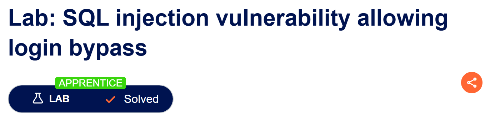
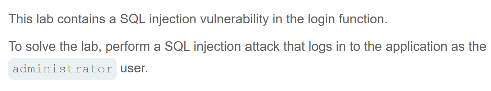

# Write-up: SQL injection vulnerability allowing login bypass  

Lab-link: https://portswigger.net/web-security/sql-injection/lab-login-bypass  
Difficulty: Apprentice  
Status: Solved

## Lab description  


## Objectives  
Bypass authentication using SQLi

## Background  
This lab is vulnerable to SQLi because  

## Steps   
### 1. Establish a baseline  
I clicked **My account** in order to log in  
I filled out `username` with `administrator` and `password` with `administrator`, which is common. Then, I got `Invalid username or password`

### 2. Test for SQLi  
To make all the information of the addministrator displayed, the password check needs to be ignored. This can be done by injecting a comment after username  
Filling out `username` with `administrator'--` and `password` with random characters like this `xxxxx`
The condition will become:
```sql
WHERE username = 'administrator'--' AND password = 'xxxxx'
```
Now, I am in `administrator` account  
And the lab was solved
