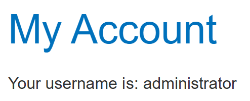
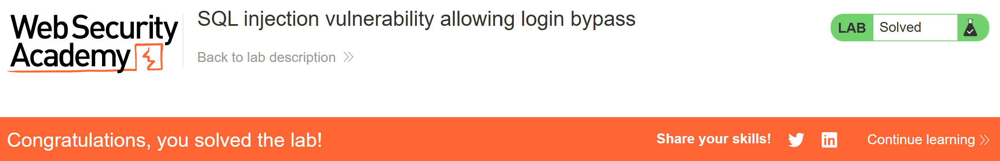

# Write-up: SQL injection vulnerability allowing login bypass  

Lab-link: https://portswigger.net/web-security/sql-injection/lab-login-bypass  
Difficulty: Apprentice  
Status: Solved

## Lab description  


## Objectives  
Bypass authentication using SQLi

## Background  
This lab is vulnerable to SQLi because user input is directly added into the SQL query without proper cleaning or safe parameterized queries  
**Example query**:  
```sql
SELECT * FROM users WHERE username = '<username>' AND password = '<password>'
```

## Steps   
### 1. Establish a baseline  
Firstly, I clicked **My account** to access the login page  
I entered the following credentials:  
**Username:** `administrator`  
**Password:** `administrator`  
And the response was: `Invalid username or password`  
This confirmed the login process was functioning normally

### 2. Test for SQLi  
To make all the information of the addministrator displayed, the password check needs to be ignored. This can be done by injecting a comment after username  
I submitted:  
**Username:** `administrator'--`  
**Password:** `xxxxx`  
The condition will become:
```sql
WHERE username = 'administrator'--' AND password = 'xxxxx'
```
**Why does this succeed?**  
Because the application only checks for the existence of the `administrator` user, authentication succeeds without verifying the password.  
Now, I am in `administrator` account  
  
And the lab was solved

