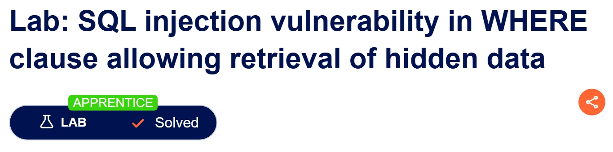
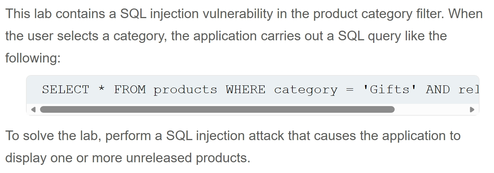
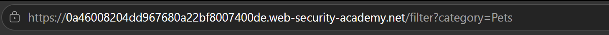
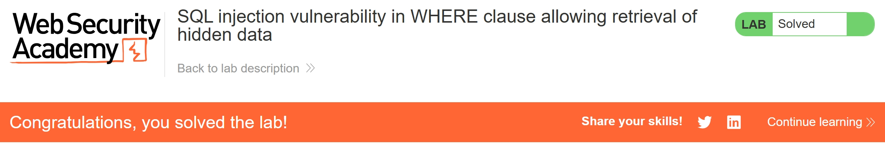

# Write-up: SQL injection vulnerability in WHERE clause allowing retrieval of hidden data   

Lab-link: https://portswigger.net/web-security/sql-injection/lab-retrieve-hidden-data  
Difficulty: Apprentice  
Status: Solved

## Lab description  


## Objectives  
Retrieve hidden products using SQLi

## Background  
This lab is vulnerable to SQLi because user input from the `category` is directly concatenated into the SQL query without validation  
**Example query:** 
```sql
SELECT * FROM products WHERE category = 'Gifts' AND released = 1
```

## Steps  
### 1. Establish a baseline  
When I first opened this lab, there were **12 products** displayed   
Next, I filtered the products by selecting **Pets** category. Only **3 products** were shown

### 2. Identify the injection point  
Now I look at the URL, I see URL path filtered with `category=Pets`  

The `category` looked like a good place to test for SQLi

### 3. Test for SQLi
I modified the URL by adding:
```text
Pets'--
```
The SQL query becomes:
```sql
SELECT * FROM products WHERE category = 'Pets'--' AND released = 1
```
**Why does this work?**  
The `--` starts a SQL comment, so it ignores the rest of the query  
As a result, the condition:
`' AND released = 1` is removed from the query  
After sending, **4 products** were displayed instead of **3**, which means the hidden product was successfully returned

### 4. Retrieve all products  
To retrieve all products, regardless of category, I injected:
```text
Pets' OR 1=1--
```
The SQL query becomes:
```sql
SELECT * FROM products WHERE category = 'Pets' OR 1=1--' AND released = 1
```
**Why use `OR 1=1`?**  
The expression `1=1` always evaluated to `TRUE`  
Therefore, every row satisfies the `WHERE` condition and the database returns all products  
Now there were 20 products shown and the lab was solved

