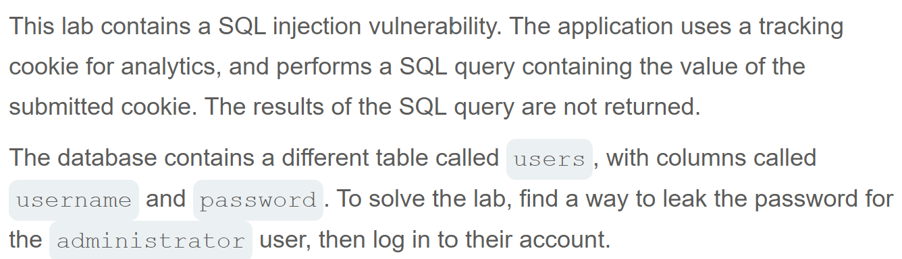
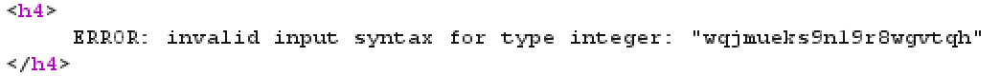
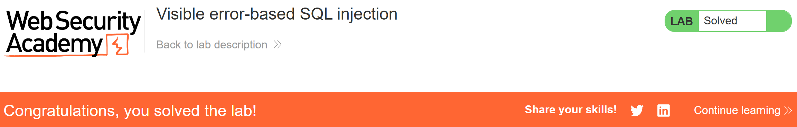

# Write-up: Visible error-based SQL injection   
  
Lab-link: https://portswigger.net/web-security/sql-injection/blind/lab-sql-injection-visible-error-based  
Difficulty: Practitioner   
Status: Solved  

## Lab description  
 

## Objectives 
Retrieve the password of `administrator` user and log into their account  

## Background  
### Visible error-based SQL injection   
**Visible error-based SQL injection** occurs when an application exposes detailed database error messages that reveal information about the database or the results of an injected query.   
In this lab, the application does not directly display query results. However, I can extract information through the error message.  

### SQL comments   
SQL comments can be used to ignore the remaining part of a query.  
In this lab, `--` comments out the rest of the original query, preventing the remaining SQL syntax from interfering with the injected payload.

### `SELECT` subqueries  
A subquery is a SQL query nested inside another query.  
In this lab, subqueries are used to check information from the `users` table:  
```sql
SELECT 'x' FROM users WHERE username='administrator'
```
The result can then be used in a Boolean condition:  
```sql
(SELECT 'x' FROM users WHERE username='administrator')='x'
```

### `CAST()`   
CAST() converts a value from one data type to another.  
For example: `CAST((SELECT 1) AS int)` converts the result of subquery to an integer  
In this lab, CAST() is used to trigger an error when the value is not a valid integer, causing the error message to reveal that value   

### Why use LIMIT 1?  
`LIMIT 1` restricts the subquery to a single row:  
```sql
SELECT 'x' FROM users LIMIT 1
```
For this attack, we only need to know whether at least one row exists, so returning multiple rows is unnecessary.

## Steps   
### 1. Establish a baseline  
Firstly, I chose the **Pets** category
In Burp Suite, I intercepted this request and sent it to Repeater  
   
The important parameter in this lab is the `TrackingId` cookie    

### 2. Identify the SQL injection vulnerability   
I injected `'` index after the value of TrackingId    
For example: `TrackingId=s2sgfBtGyudmIR8I'`  
In the response, I saw the message containing the SQL query and the value of TrackingId. The error indicated that the injected quote had left a string literal unclosed.

### 3. Comment out the rest of the query  
To prevent the remaining of the query from causing a syntax error, I added `--` to the query: `TrackingId=s2sgfBtGyudmIR8I'--`.   
The response returned `200 OK` confirming that the query was syntactically valid.   

### 4. Test CAST() subquery
I injected:  
```text
' AND 1=CAST((SELECT 1) AS int)--
```
The reponse resulted in `200 OK`. This indicated that the query was in right syntax.  

### 5. Retrieve the `administrator` username  
I used the following payload: 
```text
' AND 1=CAST((SELECT username FROM users) AS int)--
```
I got the warning: `Unterminated string literal`. This might show that the query might have the restricted number of characters. To avoid this issue, I deleted the value of TrackingId.  
I get the error message: `ERROR: more than one row returned by a subquery used as an expression`. Therefore, I used `LIMIT 1` to limit the number of rows to 1.  
The query became:   
```text
' AND 1=CAST((SELECT username FROM users LIMIT 1) AS int)--
```
And the response returned:
[Error message for administrator](img/04-administrator.png).   
The returned value was administrator. Therefore, the first row returned by the query was administrator account.  

### 6. Retrieve the administrator password  
I replaced username with password in payload to reveal the password of administrator: 
```text
' AND 1=CAST((SELECT username FROM users LIMIT 1) AS int)--
```
The error message showed the password:

The administrator password was: `wqjmueks9n19r8wgvtqh`
And the lab was solved:   

