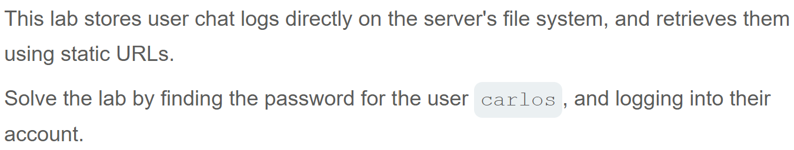
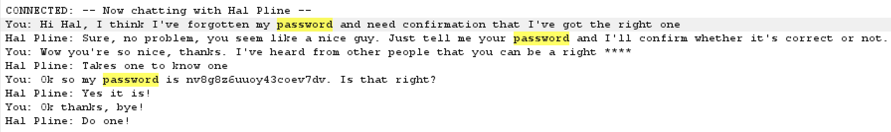
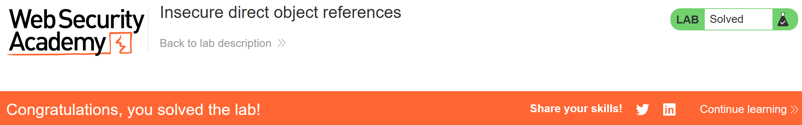

# Write-up: Insecure direct object references  
  
Lab-link: https://portswigger.net/web-security/access-control/lab-insecure-direct-object-references    
Difficulty: Apprentice  
Status: Solved  

## Lab description   
  

## Objectives  
Sign in `carlos` account  

## Background  
### Broken Access Control  
Broken Access Control occurs when an application fails to enforce proper restrictions on what authenticated users are allowed to do.  
### IDOR (Insecure Direct Object Reference)  
IDOR occurs when an application uses a user-controlled identifier to access an object but fails to verify whether the current user is authorized to access that object.  
An attacker may exploit this vulnerability by changing an identifier in a request to access another user's data.  
### Reason why we can attack  
The application relies on the provided identifier without verifying whether the authenticated user has permission to access the corresponding resource.  

## Steps  
### 1. Access the `Live chat` feature    
On the lab page, I chose `Live chat`  
I entered a message into the box of `Your message:` and clicked `Send`  
I chose `View transcript` and 1 file named `2.txt` had been downloaded  

### 2. Obtain password of `carlos` user  
In Burp Suite, I intercepted this request and sent it to Burp Repeater  
  
The response firstly showed the conversation between me and Hal Pline  
In the URL of the request, I changed `2.txt` with `1.txt`  
I sent the request and inspected the response  
In the response, the password of `carlos` user was revealed: `nv8g8z6uuoy43coev7dv`  
  
I returned to the lab page and signed in with `carlos` account    

And the lab was solved.  

