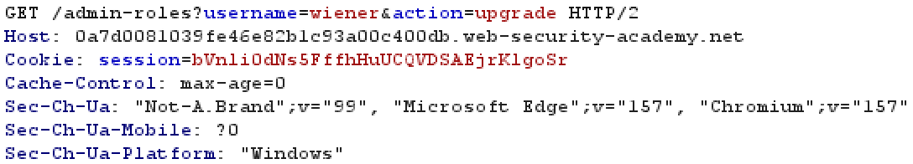
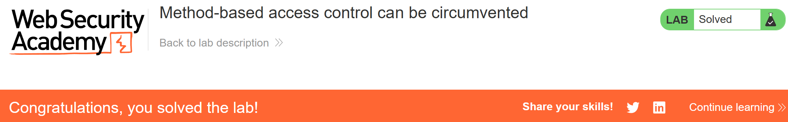

# Write-up: Method-based access control can be circumvented  
  
Lab-link: https://portswigger.net/web-security/access-control/lab-method-based-access-control-can-be-circumvented    
Difficulty: Practitioner  
Status: Solved  

## Lab description   
  

## Objectives  
Log in `wiener` account and promote to become administrator  

## Background  
### Broken Access Control  
Broken Access Control occurs when an application fails to enforce proper restrictions on what authenticated users are allowed to do.  
### IDOR (Insecure Direct Object Reference)
IDOR occurs when an application uses a user-controlled identifier to access an object but fails to verify whether the current user is authorized to access that object.  
An attacker may exploit this vulnerability by changing an identifier in a request to access another user's data.  
### Privilege escalation  
**Vertical privilege escalation:** A lower-privileged user (such as a standard user) accesses functions reserved for higher-privileged accounts (such as an administrator)—which is the case in this lab.  
**Horizontal privilege escalation:** A user accesses resources or data belonging to another user with the same privilege level.  
### Method-based access control  
Method-based access control is a security mechanism that restricts access to specific endpoints based on the HTTP request method    
### Cookies  
Cookies are small pieces of data stored by the browser and sent back to the server with every HTTP request. In web applications, session cookies are commonly used to maintain user state and identify who is making the request after authentication.  
### `GET` and `POST` methods
`GET` and `POST` are two of the most common HTTP request methods:  
`GET` is intended to retrieve data from the server, with parameters typically passed in the URL query string.  
`POST` is designed to submit data or trigger state-changing actions, sending parameters within the request body.  

## Steps  
### 1. Establish a baseline  
Firstly, I signed in with **administrator** account:
`Username: administrator`  
`Password: admin`  
I accessed **Admin panel** and chose user `wiener(NORMAL)` to upgrade user
When I signed in with **wiener** account, the lab was not solved  
Then, I returned **administrator** account and downgrade **wiener** user and upgrade **carlos** user  
In Burp Suite, I intercepted this POST request and sent it to Burp Repeater  

#### Reason why this lab was not solved  
Upgrading `wiener` directly from the `administrator` account is just normal administrative functionality, not an exploit. To solve the lab, the privilege escalation request must be triggered from an unprivileged session (`wiener`) by bypassing the server's access control.

### 2. Privilege escalation using method-based access control  
In Burp Suite, I came to sign-in request of **wiener** user  
I copied cookie session of **wiener** user   

In the POST request, I changed the value of administrator's session cookie with cookie session of **wiener** user and the `username` parameter in the request body from `carlos` to `wiener`    
After sending the modified request, the response returned `401 Unauthorized`  
This meant the server properly checked permissions on `POST` requests
Then, I right-clicked on the request and chose `change method request` to switch it from `POST` to `GET`  

I sent the modified request.  
I returned to the lab page and the lab was solved    

