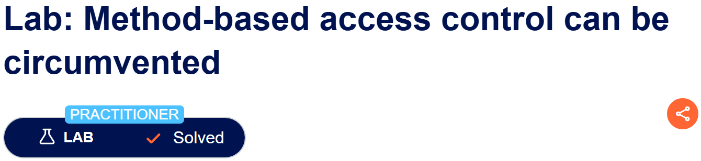
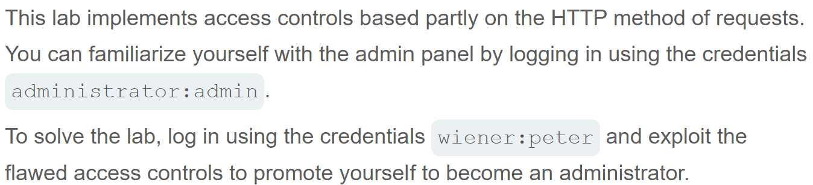
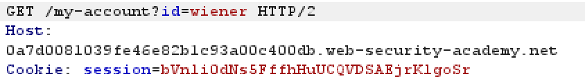

# Write-up: Method-based access control can be circumvented  
  
Lab-link: https://portswigger.net/web-security/access-control/lab-method-based-access-control-can-be-circumvented    
Difficulty: Practitioner  
Status: Solved  

## Lab description   
  

## Objectives  
Log in `wiener` account and promote to become administrator  

## Background  
### Broken Access Control  
Broken Access Control occurs when an application fails to enforce proper restrictions on what authenticated users are allowed to do.  
### IDOR (Insecure Direct Object Reference)
IDOR occurs when an application uses a user-controlled identifier to access an object but fails to verify whether the current user is authorized to access that object.  
An attacker may exploit this vulnerability by changing an identifier in a request to access another user's data.  
### Method-based access control  

### Cookies  

### `GET` and `POST` methods

## Steps  
### 1. Establish a baseline  
Firstly, I signed in with **administrator** account:
`Username: administrator`  
`Password: admin`  
I accessed **Admin panel** and chose user `wiener(NORMAL)` to upgrade user
When I signed in with **wiener** account, the lab was not solved  
Then, I returned **administrator** account and downgrade **wiener** user and upgrade **carlos** user  
In Burp Suite, I intercepted this request and sent it to Burp Repeater  

### 2. Bypass method  
I changed the request path from `/admin` to `/` and I add header: `X-Original-Url /hi` after link of `Referer` parameter  

After sending the modified request, I got `404 Not Found` status  
This means the application was processing the URL specified in the **X-Original-Url** header.  
Next, I changed the value of `X-Original-Url` from `/hi` to `/admin` and sent the request  
Now, the response returned the administration panel content   

### 3. Delete `carlos` user  
The response revealed a link to the user deletion endpoint.  
  
I replaced the value of `X-Original-Url` from `/admin` to `/admin/delete` and added `?username=carlos` to the request URL  
  
#### Why add `/admin/delete` and `and ?username=carlos`   
`/admin/delete`: The endpoint responsible for deleting a user account.  
`username=carlos`: The query parameter specifying which account should be deleted.

I returned to the lab page and the lab was solved    

