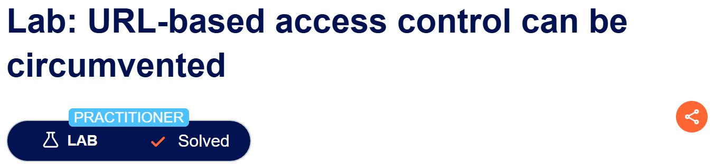
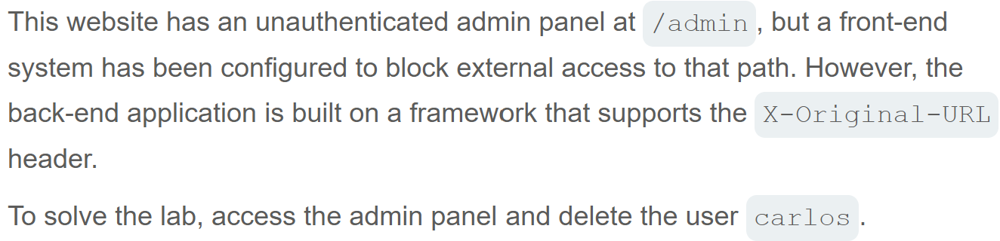
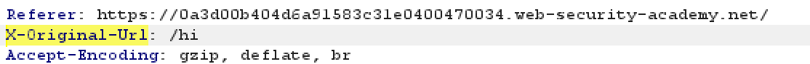
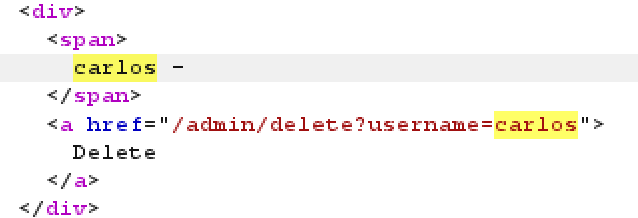
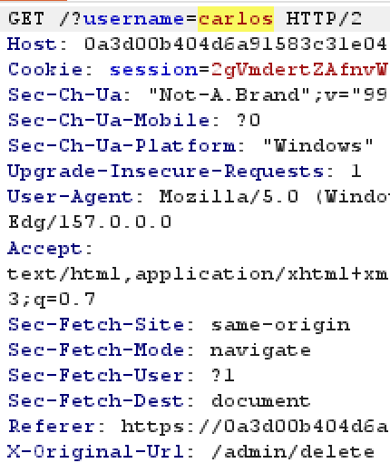
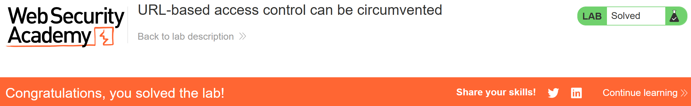

# Write-up: URL-based access control can be circumvented  
  
Lab-link: https://portswigger.net/web-security/access-control/lab-url-based-access-control-can-be-circumvented    
Difficulty: Practitioner  
Status: Solved  

## Lab description   
  

## Objectives  
Delete the user `carlos`  

## Background  
### Broken Access Control  
Broken Access Control occurs when an application fails to enforce proper restrictions on what authenticated users are allowed to do.  
### IDOR (Insecure Direct Object Reference)
IDOR occurs when an application uses a user-controlled identifier to access an object but fails to verify whether the current user is authorized to access that object.  
An attacker may exploit this vulnerability by changing an identifier in a request to access another user's data.  
### `X-Original-Url` header  

## Steps  
### 1. Establish a baseline  
In the lab's URL, I clicked `Admin panel` to get administration, but my request was denied  
In Burp Suite, I sent this request to Burp Repeater and edited it  

### 2. Using header  
After link of `Referer` parameter, I added `X-Original-Url /hi` and deleted `admin` in the URL   

I sent this edited request, then I got `404 Not Found` status  
This means   
Next, I changed the value of `X-Original-Url` from `/hi` to `/admin` and sent the request  
Now I could access the admin panel   

### 3. Delete `carlos` user  
The response showed link to delete `carlos` user  
  
I replaced the value of `X-Original-Url` from `/admin` to `/admin/delete` and added `?username=carlos` to the URL of the request  
  
#### Why add `/admin/delete` for X-Orginal-Url `and ?username=carlos` for the URL  

I returned to the lab page and the lab was solved  
And the lab was solved.  

