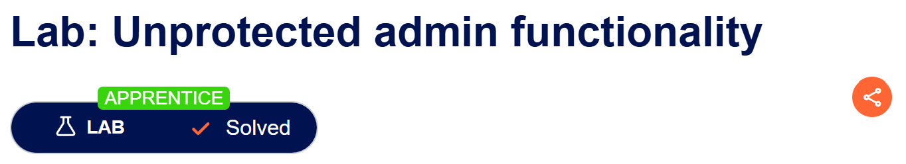
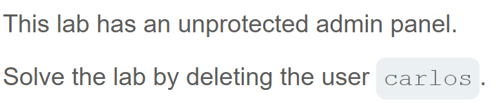
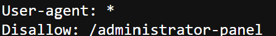
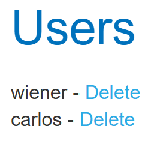
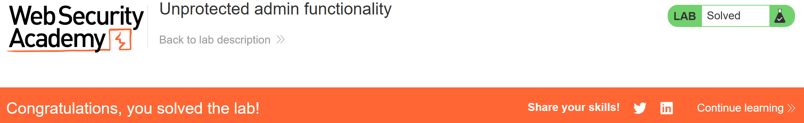

# Write-up: Unprotected admin functionality  
  
Lab-link: https://portswigger.net/web-security/access-control/lab-unprotected-admin-functionality  
Difficulty: Apprentice  
Status: Solved  

## Lab description:   
  

## Objectives  
Delete the user `carlos`  

## Background  
### `robots.txt`

## Steps  
### 1. 
I added `/robots.txt` into the URL and `Disallow` appeared    

### 2. 
Now, I replaced `/robots.txt` with the value of `Disallow`: `/administrator-panel`  
I got administration, and I choose deleting user `Carlos`
  

And the lab was solved  

