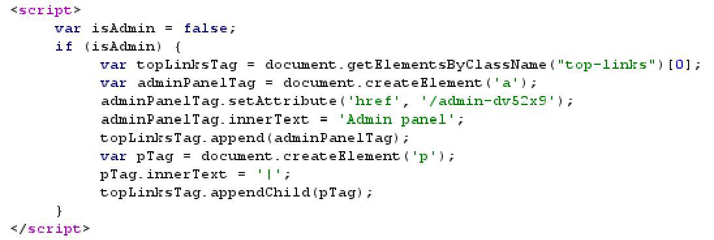
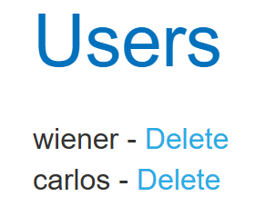
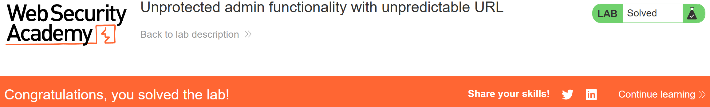

# Write-up: Unprotected admin functionality with unpredictable URL   
  
Lab-link: https://portswigger.net/web-security/access-control/lab-unprotected-admin-functionality-with-unpredictable-url  
Difficulty: Apprentice  
Status: Solved  

## Lab description:   
  

## Objectives  
Delete the user `carlos`  

## Backgrounds  
### Unprotected admin functionality    
Unprotected admin functionality occurs when an application fails to enforce proper access control on administrative features. If the admin panel can be accessed without authentication or authorization checks, an attacker may perform administrative actions by navigating directly to its URL.

## Steps  
### 1. Discover the admin panel path  
After accessing the lab, I intercepted this request and sent it to Repeater in Burp Suite    
  
The admin panel path was revealed in the response: `/admin-dv52x9`     
  

### 2. Access the admin panel  
Now, I added the lab URL with `/admin-dv52x9` to access the admin panel.  
  
The panel was accessible without requiring administrator authentication.  

### 3. Delete `Carlos` user  
I clicked `Delete` option next to the user `Carlos`.

And the lab was solved.  

