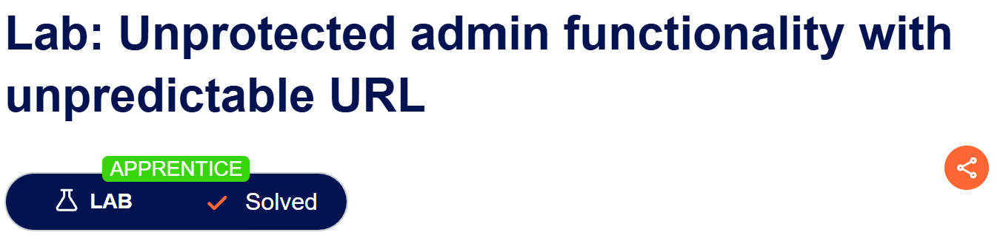
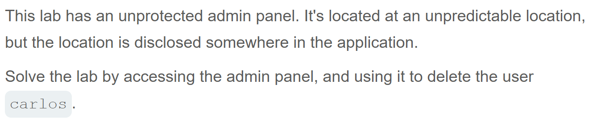

# Write-up: Unprotected admin functionality with unpredictable URL   
  
Lab-link: https://portswigger.net/web-security/access-control/lab-unprotected-admin-functionality-with-unpredictable-url  
Difficulty: Apprentice  
Status: Solved  

## Lab description:   
  

## Objectives  
Delete the user `carlos`  

## Steps  
### 1. Discover the admin panel path  
After accessing the lab, I intercepted this request and sent it to Repeater in Burp Suite    
The response showed the admin panel path     

### 2. Access the admin panel  
Now, I added the lab URL with `/admin-dv52x9` to access the admin panel.  
  
The panel was accessible without requiring administrator authentication.  

### 3. Delete `Carlos` user  
I clicked `Delete` option next to the user `Carlos`.

And the lab was solved.  

