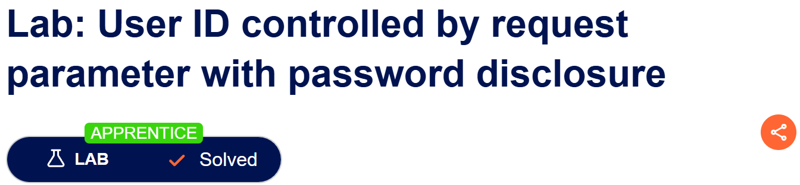
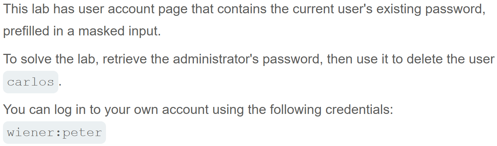
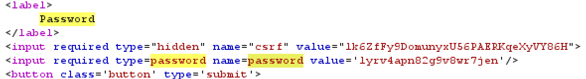
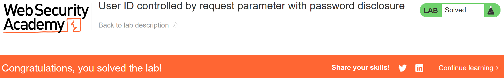

# Write-up: User ID controlled by request parameter with password disclosure  
  
Lab-link: https://portswigger.net/web-security/access-control/lab-user-id-controlled-by-request-parameter-with-password-disclosure  
Difficulty: Apprentice  
Status: Solved  

## Lab description:   
  

## Objectives  
Delete the user `carlos` 

## Background  
### Broken Access Control  
Broken Access Control occurs when an application fails to enforce proper restrictions on what authenticated users are allowed to do.  
### IDOR (Insecure Direct Object Reference)
IDOR occurs when an application uses a user-controlled identifier to access an object but fails to verify whether the current user is authorized to access that object.  
An attacker may exploit this vulnerability by changing an identifier in a request to access another user's data.  

## Steps  
### 1. Log into `wiener` account  
I logged in with the information provided by the lab:  
Username: `wiener`  
Password: `peter`  
The account was a normal user  

### 2. Retrieve the password of `administrator`  
I intercepted HTTP request in Burp Suite.  
  
I changed the `id` parameter from `wiener` to `administrator`  
I sent the request and inspected the response.   
In the response, the password of `administrator` was revealed: `lyrv4apn82g9v8wr7jen`  
  

### 3. Delete `carlos` user   
I returned to the lab page and sign in as administrator    
I accessed the admin panel and clicked `Delete` option next to the user `carlos`  
   

And the lab was solved.  

