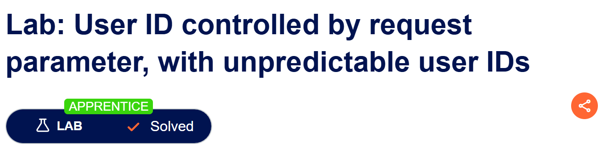
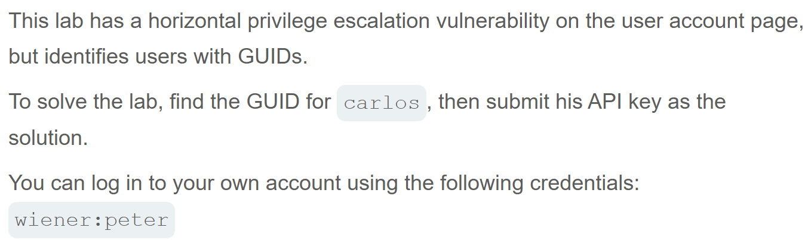
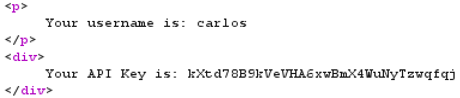
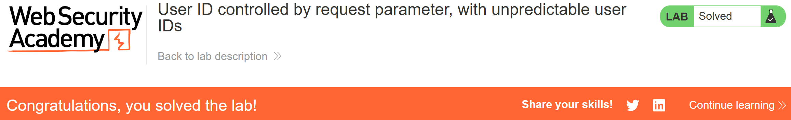

# Write-up: User ID controlled by request parameter, with unpredictable user IDs  
  
Lab-link: https://portswigger.net/web-security/access-control/lab-user-id-controlled-by-request-parameter-with-unpredictable-user-ids  
Difficulty: Apprentice  
Status: Solved  

## Lab description:   
  

## Objectives  
Obtain the API key for the user `carlos` 

## Backgrounds  
### Broken Access Control  
Broken Access Control occurs when an application fails to enforce proper restrictions on what authenticated users are allowed to do.  
### IDOR (Insecure Direct Object Reference)
IDOR occurs when an application uses a user-controlled identifier to access an object but fails to verify whether the current user is authorized to access that object.  
An attacker may exploit this vulnerability by changing an identifier in a request to access another user's data.  

## Steps  
### 1. Log into `wiener` account  
I logged in with the information provided by the lab:  
Username: `wiener`  
Password: `peter`  
The account was a normal user  
I intercepted HTTP requet and sent it to Repeater in Burp Suite.  
  

### 2. Obtain `id` of `carlos` user  
I returned Home and clicked each post to get carlos's post  
  
I clicked `carlos`.
In Burp Suite, I got the id of `carlos` user  
  

### 2. Obtain API Key of `carlos` user  
Now, I changed the `id` parameter from `565e0942-0a22-4982-9bab-2b85b6612246` to `e1b1f68f-3fae-45c5-90a4-b5bd16d36ea0` (`wiener` to `carlos`)    
I sent the request and inspected the response.   
In the response, API Key of `carlos` user was revealed: `kXtd78B9kVeVHA6xwBmX4WuNyTzwqfqj`
  
I returned to the lab page and submitted the retrieved API Key 

And the lab was solved.  

