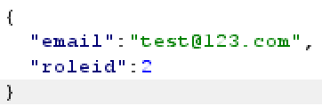
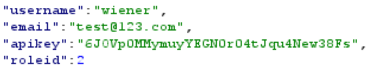
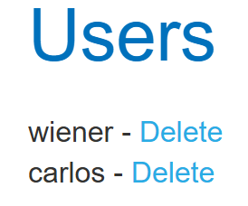
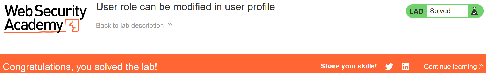

# Write-up: User role can be modified in user profile  
  
Lab-link: https://portswigger.net/web-security/access-control/lab-user-role-can-be-modified-in-user-profile  
Difficulty: Apprentice  
Status: Solved  

## Lab description:   
  

## Objectives  
Delete the user `carlos`  

## Backgrounds  
### Broken Access Control  
Broken Access Control occurs when an application fails to enforce proper restrictions on what authenticated users are allowed to do.  

## Steps  
### 1. Log into `wiener` account  
I logged in with the information provided by the lab:  
Username: `wiener`  
Password: `peter`  
The account was a normal user

### 2. Access the admin panel  
I entered `test@123.com` in the email field and clicked `Update email`  
In Burp Suite, I intercepted this request and inspected the HTTP response.  
    
The response revealed that account's roleid was 1: `"roleid": 1`  
  
To get the administration, the account's roleid should be 2.  
In the request body, I injected `,` after the email and `"roleid": 2`  
  
I sent the request and inspected the response. The value of `roleid` has changed from `1` to `2`  
    

Then, I reloaded the page and I can access admin panel without requiring administrator authentication.  
    

### 3. Delete `Carlos` user  
I clicked `Delete` option next to the user `Carlos`.

And the lab was solved.  

  
