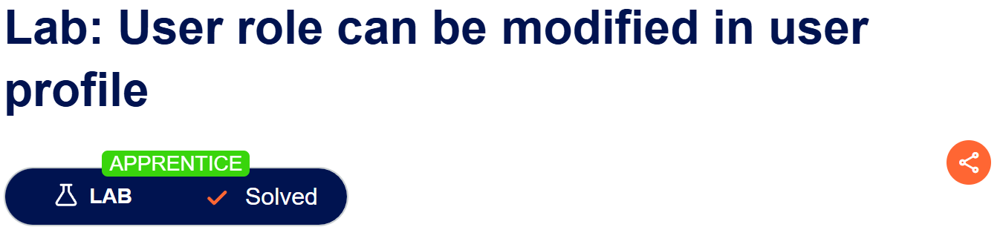
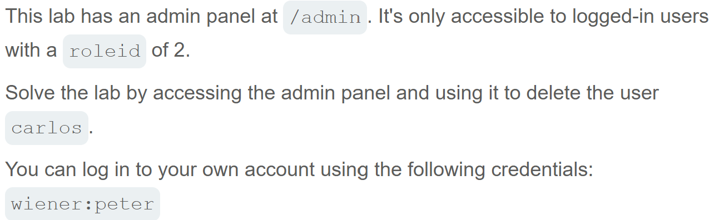
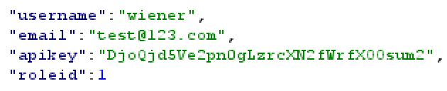

# Write-up: # Write-up: User role controlled by request parameter  
  
Lab-link: https://portswigger.net/web-security/access-control/lab-user-role-controlled-by-request-parameter  
Difficulty: Apprentice  
Status: Solved  

## Lab description:   
  

## Objectives  
Delete the user `carlos`  

## Backgrounds  
### Broken Access Control  
Broken Access Control occurs when an application fails to enforce proper restrictions on what authenticated users are allowed to do.  

### Cookies  
Cookies are values stored by the browser and sent to the server with subsequent HTTP requests.  
Cookies controlled by the client should not be trusted as the sole basis for granting privileges.    

## Steps  
### 1. Log into `wiener` account  
I logged in with the information provided by the lab:  
Username: `wiener`  
Password: `peter`  
The account was a normal user

### 2. Access the admin panel  
I intercepted this requet in Burp Suite and inspected the HTTP response.  

The response contained the following header: `Set-Cookie: Admin=false`  

I opened the browser's Developer Tools and navigated to the Application panel to inspect the stored cookies.  
I changed the value of the `Admin` cookie from `false` to `true`.  
  
Then, I reloaded the page and I can access admin panel without requiring administrator authentication.  
  

### 3. Delete `Carlos` user  
I clicked `Delete` option next to the user `Carlos`.

And the lab was solved.  

  
  
Lab-link: https://portswigger.net/web-security/access-control/lab-user-role-controlled-by-request-parameter  
Difficulty: Apprentice  
Status: Solved  

## Lab description:   
  

## Objectives  
Delete the user `carlos`  

## Backgrounds  
### Broken Access Control  
Broken Access Control occurs when an application fails to enforce proper restrictions on what authenticated users are allowed to do.  

### Cookies  
Cookies are values stored by the browser and sent to the server with subsequent HTTP requests.  
Cookies controlled by the client should not be trusted as the sole basis for granting privileges.    

## Steps  
### 1. Log into `wiener` account  
I logged in with the information provided by the lab:  
Username: `wiener`  
Password: `peter`  
The account was a normal user

### 2. Access the admin panel  
I intercepted this requet in Burp Suite and inspected the HTTP response.  

The response contained the following header: `Set-Cookie: Admin=false`  

I opened the browser's Developer Tools and navigated to the Application panel to inspect the stored cookies.  
I changed the value of the `Admin` cookie from `false` to `true`.  
  
Then, I reloaded the page and I can access admin panel without requiring administrator authentication.  
  

### 3. Delete `Carlos` user  
I clicked `Delete` option next to the user `Carlos`.

And the lab was solved.  

