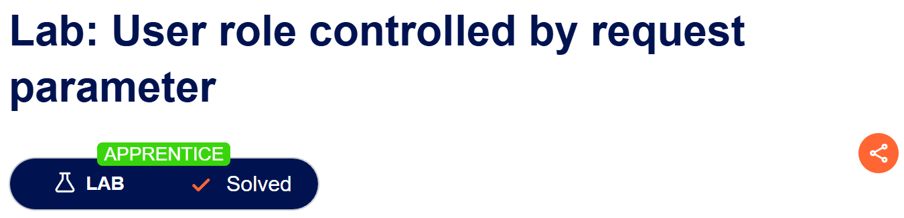
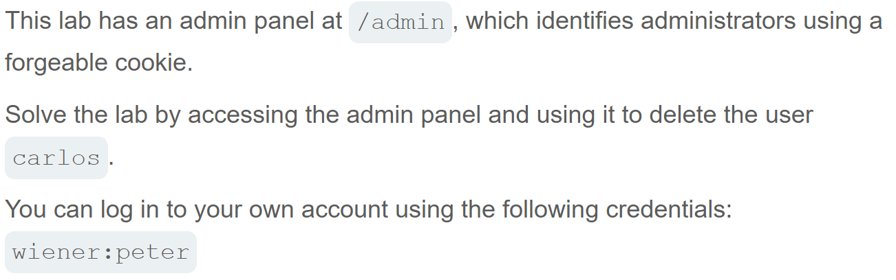
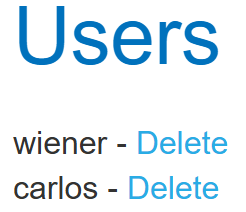
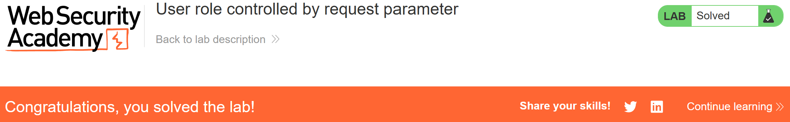

# Write-up: User role controlled by request parameter  
  
Lab-link: https://portswigger.net/web-security/access-control/lab-user-role-controlled-by-request-parameter  
Difficulty: Apprentice  
Status: Solved  

## Lab description:   
  

## Objectives  
Delete the user `carlos`  

## Backgrounds
### Inspector  

## Steps  
### 1. Log into `wiener` account  
I filled in with the information provided by the lab:
Username: `wiener`  
Password: `peter`

### 2. Access the admin panel  
I intercepted this requet:

The response showed that `Set-Cookie: Admin=false`

I turned on `Inspect` page of the web and change Admin's cookies to `True`

Then, I reloaded the page and I can access admin panel without requiring administrator authentication.  
  

### 3. Delete `Carlos` user  
I clicked `Delete` option next to the user `Carlos`.

And the lab was solved.  

