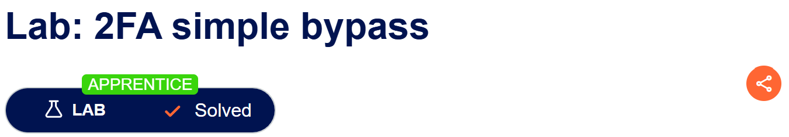
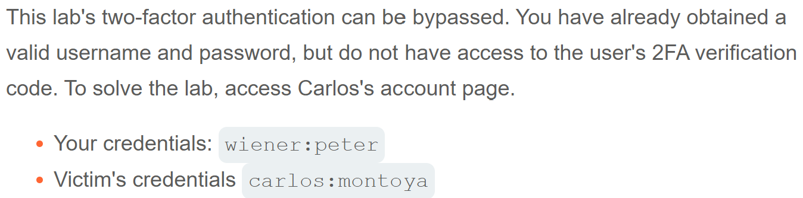
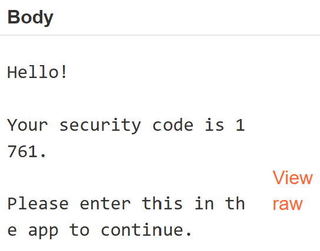
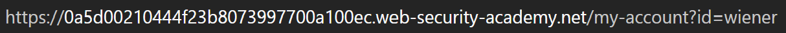
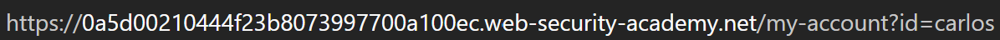
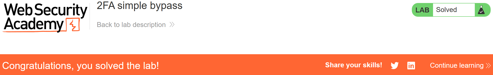

# Write-up: 2FA simple bypass  
  
Lab-link: https://portswigger.net/web-security/authentication/multi-factor/lab-2fa-simple-bypass  
Difficulty: Apprentice  
Status: Solved  

## Lab description:   
  

## Objectives  
Access `carlos` account without 2FA vertification code   

## Background  
### Reason why this lab can be solved  
The application does not properly enforce the 2FA verification step before granting access to the account.  

## Steps  
### 1. Log in with `wiener` account  
I used provided information to log in:  
`username: wiener`  
`password: peter`   
After logging in, I clicked **Email client** button and 2FA verification code was retrieved   
  
I entered the code and successfully logged in as `wiener`  
I then inspected the account page URL, which was: `/my-account?id=wiener`   
  

### 2. Log in with `carlos` account  
Similar as Step 1  
I used provided information to log in:  
`username: carlos`  
`password: montoya`  
After logging in, I clicked **Email client** button and 2FA verification code was retrieved   
  
I entered the retrieved 2FA verification code but I was unable to access `carlos` account    
#### Reason  
Although I had submitted the correct username, password, and 2FA verification code, the application did not grant access to the account.  
This indicated that the account page might be accessible without completing the 2FA verification step.  

### 3. Bypass 2FA verification code  
I changed the link by replacing `/login2` with `/my-account?id=carlos`  
Instead of completing the 2FA verification process through `/login2`, I accessed the account page directly.  
  
I entered the link and I could access with `carlos` account  
And the lab was solved   

