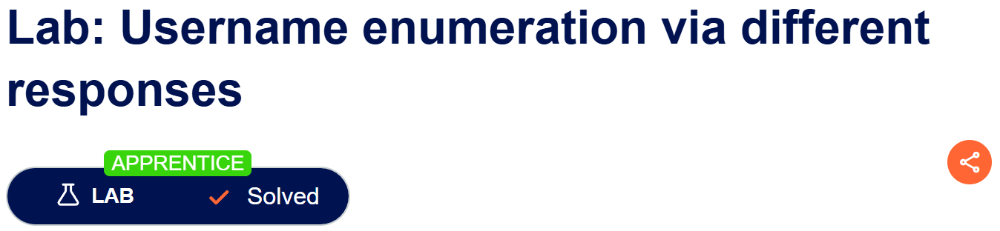
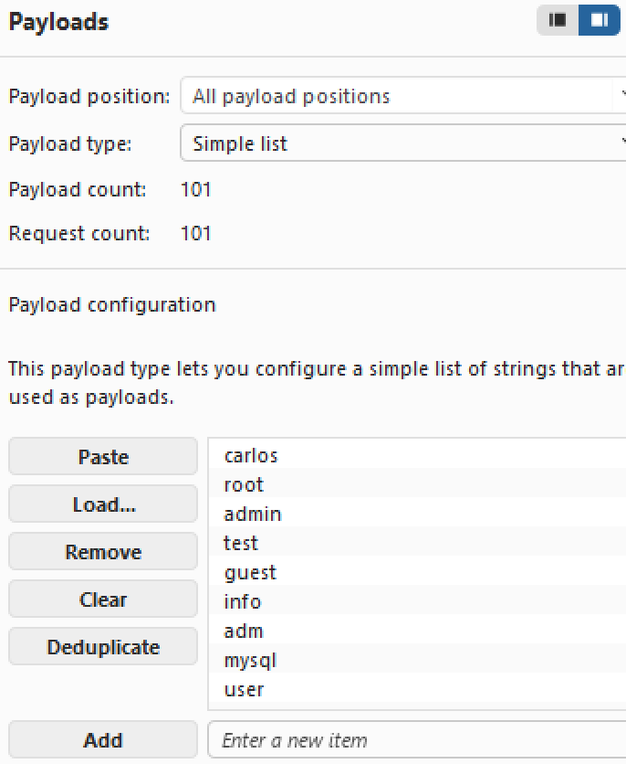
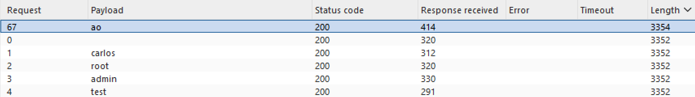
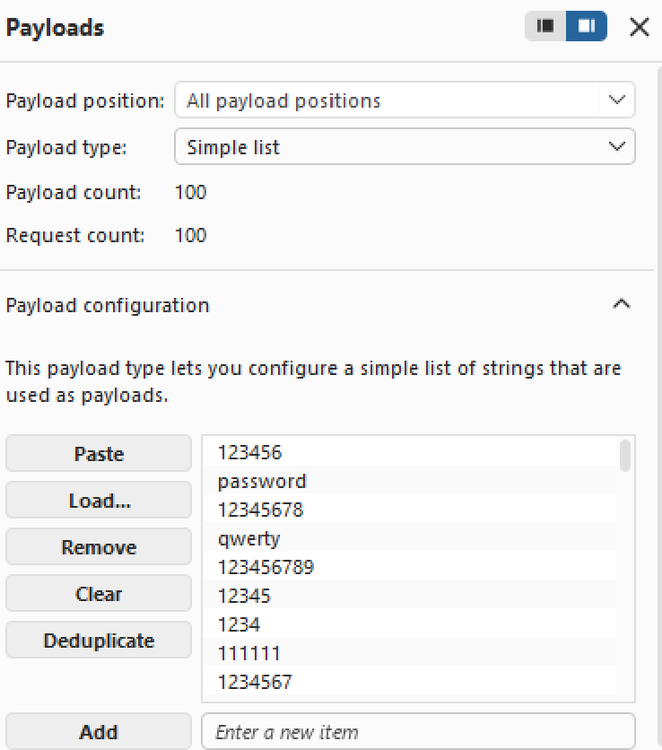
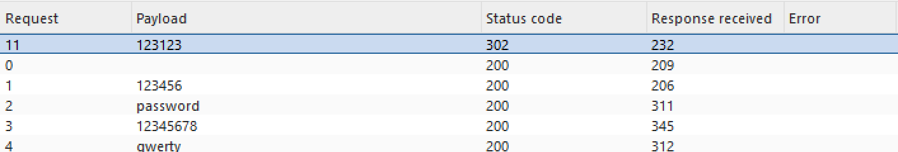
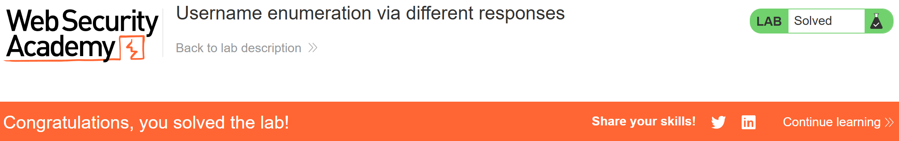

# Write-up: Username enumeration via different responses  
  
Lab-link: https://portswigger.net/web-security/authentication/password-based/lab-username-enumeration-via-different-responses  
Difficulty: Apprentice  
Status: Solved  

## Lab description:   
  

## Objectives  
Find correct username and password in the provided list 

## Background  
### [Candidate usernames](https://portswigger.net/web-security/authentication/auth-lab-usernames)  
A list of potential usernames provided by PortSwigger  
### [Candidate passwords](https://portswigger.net/web-security/authentication/auth-lab-passwords)
A list of potential passwords provided by PortSwigger  

## Steps  
### 1. Establish a baseline  
Firstly, I clicked `My account` to log in  
`Username: test`  
`Password: 123`  
Username and Password can be filled with whatever you want  
In Burp Suite, I intercepted the POST request and sent it to Burp Repeater  
  

### 2. Find correct username in the list  
I sent the request to Burp Intruder   
I selected the value of username `username=§test§` as the payload position and clicked **Add §**  
I chose **Sniper attack** because there was only 1 payload position
For the payload configuration:  
Payload type: `Simple list`
I copy and paste the list of **candidate usernames**  

After sending attack, the length of the response with `username=ao` was 3354, while the others were 3352  
This difference indicated that the application responded differently when valid username was submitted
Therefore, valid username was `ao`  
  

### 3. Find correct password in the list   
I clicked `clear §` on `username=§test§` and replaced `test` with `ao`  
Similar as finding username, I added § for `password=§123§`, used **Sniper attack**, cleared the old list and pasted the list of **candidate passwords**  
  
After sending attack, the response with `password=123123` got status **302**, while the others got status **200**  
This indicated that the application responded differently when the correct password was submitted

Therefore, correct password was `123123`  

### 4. Log in  
I returned the lab page and used username and password which were found to log in  
`Username: ao`  
`Password: 123123`  
And the lab was solved  

